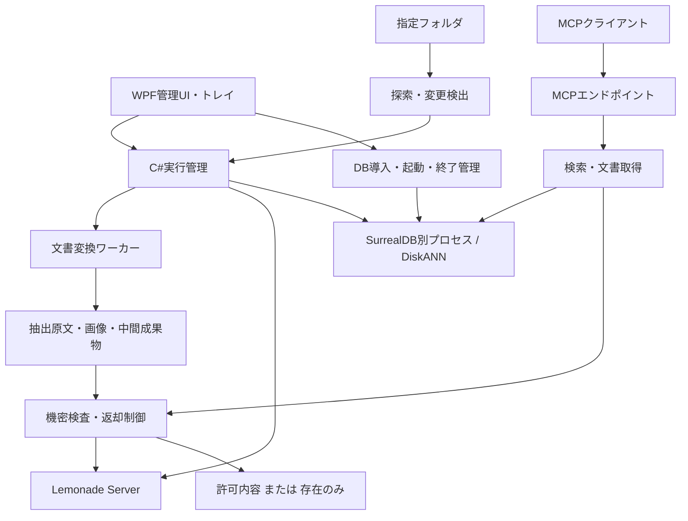

# Local RAG System 設計書

- 作成日: 2026-11-02（日本時間）
- 状態: 基本設計。実装・実機検証に伴う変更は本書と実装計画に反映する。
- 改訂: 同日の追加指示により、SurrealDBを組み込みから別プロセス方式へ変更。
- 対象: Windows 11 / x86_64 / 単一ユーザー
- 初回リリース目標: 0.0.0（テキストファイル・常駐処理・MCP取得）。Word・PDF・音声は後続。
- 関連文書: [実装計画](ImplementationPlan.md)

## 1. 目的と前提

指定されたローカルフォルダ内の文書と音声を継続的に取り込み、ローカルAIによって検索用データを作成する。MCPクライアントから検索・文書全体の取得を行えるようにし、返却直前に機密検査を行う。

想定PCはシステム全体でメモリ32GB、APUを搭載する。対象文書は数百件程度、音声は1ファイル30分～1時間を想定する。処理速度より通常のPC操作への影響を小さくすること、途中終了から復旧できることを重視する。

主言語はC#とし、変換ライブラリなどの依存関係によってPython等を併用する。Microsoft Officeはインストール済みとする。初版はユーザーのログインセッション内で動作し、ログアウト中は処理しない。

本書は将来のWord・PDF・音声対応を含む全体設計を保持する。ただし初回リリース0.0.0は、UTF-8の.txt/.md本文の取り込み、常駐監視、MCPのsearch/fetchによる取得までに限定する。Office、Docling、STTは0.0.0の依存要件に含めない。常駐処理とMCP取得の実機での成功を確認してリリースし、後続形式の完成を待たない。具体的なリリース判定条件と実装順序は実装計画1節を正とする。

## 2. 要件対応

| ID | 要件 | 設計方針 |
|---|---|---|
| R01 | フォルダ探索・更新監視 | 全登録フォルダを1周期として探索・処理。完了後15分を初期値として再実行 |
| R02 | Word・PDF・音声・テキスト | 種別別アダプターと共通工程を組み合わせる |
| R03 | Word・PDFパイプライン | Markdown変換、第一次整形、分類、第二次整形、分割、Embedding |
| R04 | 音声パイプライン | STT、整形、分類、要約、任意分割、Embedding |
| R05 | テキストパイプライン | 分類、整形、分割、Embedding |
| R06 | 最小設定と管理UI | フォルダ・AI接続設定でローカル処理を開始可能。詳細設定には初期値を提供 |
| R07 | MCP・機密検査 | search/fetchの共通返却経路でパターンとローカルLLM検査 |
| R08 | タスクトレイ常駐 | WPFウィンドウを閉じても常駐。終了はトレイから明示 |
| R09 | Lemonade Server | Chat、Embedding、STTを用途別モデルで接続 |
| R10 | 別プロセスのSurrealDB・DiskANN | 未起動なら必要に応じて自動導入・起動。終了時にDBも停止するか設定可能 |
| R11 | C#主体 | UI、スケジューラー、処理状態、検索、検査、MCPはC# |
| R12 | Office Interop利用可 | 旧形式変換等の専用ワーカーとして隔離 |
| R13 | Windows 11 x64 | win-x64を配布・検証対象とする |

## 3. 技術選定と検証境界

| 領域 | 方針 | 検証事項 |
|---|---|---|
| 本体 | .NET 10 LTS / C# | SDK・ランタイムのバージョンを固定 |
| UI | WPF + トレイアイコン | 高DPI、閉じる/再表示/終了、二重起動 |
| DB | SurrealDB 3.3.5 / 別プロセス / SurrealKV | 固定版・SHA-256検証、自動起動、認証、所有プロセスの通常終了 |
| ベクトル | SurrealDB内のDISKANN | 作成、追加、検索、削除、再起動、検索可能になる時点 |
| AI | Lemonade Server | 実際のAPI、ローカルモデル、入力上限、JSON出力、STT時刻 |
| 文書変換 | Python + Doclingを第一候補 | 日本語・表・画像・OCR・オフライン実行 |
| Word互換 | Microsoft.Office.Interop.Word | STA・ダイアログ・タイムアウト・ユーザーのWordへの影響 |
| MCP | 公式C# SDK | Streamable HTTP、認証、対象ChatGPT環境での実呼び出し |

旧構成の`SurrealDb.Embedded.SurrealKv 1.0.0`は内蔵エンジン3.0.5のためDISKANNを利用できなかった。ユーザーの追加指示に従い、公式Windows x64版SurrealDB 3.3.5を別プロセスとして実行し、`SurrealDb.Net 1.0.0`からHTTPで接続する構成へ変更した。HNSWや別DBへの置換は行わない。

実機で自動導入・起動・通常終了、DiskANNの作成・検索・更新・削除、プロセス再起動後のチェックポイントとベクトル検索を確認済み。詳細は[技術検証記録](TechnicalValidation.md)の追補を参照。

## 4. 全体構成

DBデータファイルを開くのはSurrealDBプロセスのみ。常駐アプリはHTTPで接続し、変換ワーカーにはDB接続を渡さない。管理UIとバックグラウンド処理は責務を分離し、UIスレッドで変換・推論・DB待機を行わない。

推奨プロジェクト分割はDomain、Application、Infrastructure、Desktop、Diagnostics、Testsとする。追加の変換ワーカーはworkers配下に置く。初期実装では過剰なプロジェクト分割を避け、責務境界をインターフェースで保つ。

## 5. ライフサイクルと低負荷運転

- ログイン中のユーザー権限で実行し、管理者権限を必須にしない。
- 管理画面を閉じるとトレイへ格納する。終了操作は処理中断と状態保存を行う。
- 取り込みは標準で1件ずつ、AI呼び出しも原則直列とする。
- アプリと所有する変換ワーカーは低優先度で動作する。Lemonade Serverの優先度を無断変更しない。
- 別プロセスの推論負荷は、入力長、同時要求数、呼び出し間隔、モデル常駐数によって抑制する。
- メモリ圧迫、バッテリー駆動、ユーザー操作中などの一時停止条件を設定可能にする。
- 検索と返却前検査は取り込みより優先する。ただし、実行中のモデル要求を安全に中断できるとは仮定しない。
- 同じモデルを利用する処理のまとめ実行は将来の最適化とし、復旧単位を崩さない。

### 5.1 SurrealDBの導入・起動

標準は`127.0.0.1:8000`。ポートは1024～65535から変更でき、変更は再起動後に適用する。固定の専用保存先を使い、既存インストールやPATH上の実行ファイルを上書きしない。

1. アプリの設定を読み、保存先ごとの管理ロックを取得する。
2. ポートが使用中なら、SurrealDBの版と認証を確認して接続する。認証情報がない場合は管理画面で設定できる。別サービスや非対応版であれば自動置換せず、エラーを表示する。
3. 未起動なら`tools/surrealdb/3.3.5/surreal.exe`を確認する。なければ公式GitHub Releaseから取得し、固定SHA-256を照合してから配置する（約307MiB）。不一致・中断時は実行しない。既存ファイルのハッシュも起動前に確認する。
4. 初回はランダムパスワードを生成し、Windows DPAPI CurrentUserで`server/credentials.dpapi`へ保存する。パスワードを設定JSON・コマンドライン・ログに書かない。子プロセス環境で渡す。
5. SurrealDBを非表示の専用コンソール・低優先度で起動する。認証を必須とし、外部向けアドレスで待ち受けない。接続準備が整うまで待ち、タイムアウトを表示する。

初回導入にはインターネット接続が必要。その後は検証済み実行ファイルでオフライン起動可能。自動更新は行わず、更新版は移行・互換性検証後にアプリから指定する。

### 5.2 SurrealDBの終了と所有権

`Database.StopOnExit`の初期値は`true`。画面のチェックを外して保存するとDBを残したままアプリを終了できる。ウィンドウの閉じる操作はトレイ格納なのでDBを停止しない。

起動したDBのPID・起動時刻・実行ファイル絶対パス・ポートを`server/ownership.json`に保存する。次回起動ではこれらを照合して同じプロセスに限り管理を引き継ぐ。名前やポートだけでプロセスを終了しない。ユーザーが独立に起動した既存サーバーは、終了設定がONでも停止対象にしない。

アプリ終了時は処理中断とDB操作完了を待つ。停止設定がONなら、専用補助プロセスが対象の私有コンソールの構成とプロセス同一性を再検証し、CTRL_BREAKを1回だけ通知する。保存・終了を待ち、失敗時に強制終了や2回目の通知へ切り替えない（2回目の通知はサーバー側で強制終了になり得る）。失敗時はアプリを開いたままにして再確認を可能にする。DBを残す設定へ変更することもできる。

異常終了時は次回起動で所有権を照合する。DBが残存していて応答しない場合は二重起動しない。旧組み込みDBの試験ファイルは保持し、新しい`server/data`へ無断変換しない。旧DBからの自動移行は未実装。

## 6. フォルダ探索と更新判定

### 6.1 周期の定義

初期監視間隔は15分。全登録フォルダの探索と、その周期に検出した処理対象の試行が終了した時点をcycle_completed_atとし、次回実行をその時点＋監視間隔とする。固定時刻タイマーで重複起動しない。

ファイル単位の再試行は有限回とする。上限到達時は失敗・保留として周期を完了できる。設定不備など全体障害でもビジーループせず、間隔を置いて再試行する。

手動実行要求は集約する。起動時は保存済み未完了ジョブを回復してから探索を行う。スリープ復帰時は経過した周期をすべて再現せず、必要な1回だけを実行する。一時停止中は新規処理を開始しない。

### 6.2 検出規則

フォルダごとに再帰探索、対象拡張子、除外パターンを持つ。標準ではOffice一時ファイル、アプリ自身の保存領域、シンボリックリンクやジャンクションを除外する。重複する監視ルートは正規化して同じファイルを重複処理しない。

パス、サイズ、更新日時で候補を抽出し、処理前にSHA-256等で内容を識別する。処理用スナップショット取得前後のサイズ・更新日時を確認し、途中変更時は再取得する。低頻度の全件ハッシュ照合で同一メタデータの変更を補う。

内容を読めない、書き込み中、アクセス拒否、暗号化文書などは明示的に保留する。アクセスできないフォルダを空と見なして削除処理しない。削除は正常に完了した探索範囲についてだけ判定する。

### 6.3 公開状態

変更または削除を検出した旧版は検索対象から外す。新版は全工程とインデックスの準備が完了してから公開する。再処理失敗中に旧版を自動復活させない。名前変更の同一性が確定できない場合は、削除＋新規として安全に処理する。

## 7. 共通パイプライン

| 対象 | 標準の工程順 |
|---|---|
| Word / PDF | 変換 → 第一次整形 → 分類 → 第二次整形 → 意味チャンク分割 → Embedding |
| 音声 | STT → 整形 → 分類 → 要約 → 任意チャンク分割（初期値OFF）→ Embedding |
| テキスト | 分類 → 整形 → 意味チャンク分割 → Embedding |

工程ごとにenabled、prompt_version、model_profile、input_limit、timeout、retry_policyを持つ。分類別工程には継承/有効/無効を設定できる。省略工程は入力をそのまま次工程へ渡す。

分類を無効化した場合は既定分類に進む。分類不明は既定分類または保留とし、自動的に対象外にしない。対象外分類はEmbeddingと検索公開を行わない。機密検査とは別の決定である。

ユーザー記述の「整形、分類、省略の処理を省略」は、音声では整形・分類・要約を個別に省略可能という意味で扱う。

### 7.1 分類とプロンプト

分類には不変ID、表示名、説明、処理設定、除外フラグを持つ。初期分類は一般文書、仕様・設計、手順書、議事録、対象外とする。追加、名称変更、プロンプト変更、手動分類を認める。

プロンプトはシステム同梱版とユーザー変更版を分け、履歴・復元・サンプル実行・差分確認を提供する。利用可能な変数と応答形式は検証し、任意コードの実行には使わない。

ジョブ開始時の設定スナップショットを固定する。変更時には影響する工程以降を再実行する。分類の除外指定や機密ルールの変更は、検索返却の可否に即時反映する。

### 7.2 LLMの出力検証

文書内容は命令ではなく入力データとして渡し、LLMにファイル操作やツール実行を許可しない。分類は許可済み分類IDのみ、分割は実在する段落IDと順序のみ受け付ける。

チャンク本文をLLMに再生成させず、段落範囲の指定からC#で切り出す。範囲の欠落、重複、逆転、入力上限を検証する。整形は可能な限り修正差分と削除対象で表し、数値・否定・固有名詞の変更や大量削除を検知して保留できるようにする。

長文処理は見出し、ページ、段落等で入力を分ける。黙って切り捨てない。JSON形式対応は接続テストで確認し、構文不正時は有限回再試行後に保留する。

## 8. ファイル種別ごとの処理

### 8.1 Word・PDF

Doclingを別プロセスから実行し、Markdownと構造化抽出データを生成する。段落・表・画像ID、PDFのページ番号、抽出可能な位置情報を保持する。存在しないWordページ番号を推測して付与しない。

抽出原文は整形前に保存する。ヘッダー・フッターを検索用本文から取り除いても、機密表示等の根拠を保持する。スキャンPDFにはローカルOCRを使用し、抽出失敗を空文書として正常終了させない。

画像は埋め込みMarkdownに対応する。保存時は画像を独立した資産として管理し、必要時に埋め込みMarkdownを再構成してもよい。テキストLLMやEmbeddingにはBase64を入力せず、画像ID、キャプション、OCRテキストを使う。画像の視覚的意味の検索は将来拡張とする。

旧.doc等の互換性対応にはWord Interopワーカーを使える。STA・直列実行、マクロ無効化、外部リンク更新抑止、読み取り専用、タイムアウトを必須とする。ユーザーが起動したWordを終了しない。失敗時に本体を巻き込まない。

### 8.2 音声

原音声、文字起こし原文、整形結果、要約を別々に保持する。要約に根拠となる発言区間を対応付ける。話者や時刻はバックエンドから検証可能な情報が得られる場合だけ記録する。

STT入力の音声分割とRAG用テキストのチャンク分割は別設定。30分～1時間の入力を部分的に再開できるようにする。標準の検索対象は要約であり、後から文字起こし全文も対象に追加可能な構造にする。

RAG用分割OFFでEmbedding上限を超えた場合は、入力上限超過で保留する。短い要約への再生成、意味分割ON、長文時のみ機械分割をユーザーが選べる。既定で勝手に分割・切り捨てしない。

### 8.3 テキスト

0.0.0はUTF-8（BOM可）の.txt/.md本文を対象とする。後続の候補は.csv/.tsv/.json/.yaml/.yml/.xml/.html/.htm/.log。実装済み形式と予定形式をUIで区別する。CP932の明示指定は後続対応とし、復号エラーを置換文字で隠さない。

HTMLはスクリプトを実行せず、外部資源を取得しない。CSV列名、JSONキー、コード構造等は種別別に保持する。未知のバイナリをテキスト扱いしない。

## 9. AI接続

Chat、Embedding、STTのプロファイルを分離する。Lemonadeの接続先と各モデルを選択し、短いテスト要求で機能・返却形式・次元数を確認する。

標準接続先はループバックとし、ローカル実行モデルのみを使用する。Lemonadeがクラウドモデルを公開できることに注意し、クラウド転送設定を検出・拒否する。判別できない場合は確認待ちとし、ローカル推論を検証済みと表示しない。

APU型番と実測が得られるまで具体的なモデルサイズ、速度、最大常駐メモリを保証しない。接続失敗、モデル未導入、VRAM/メモリ不足は別の状態として表示する。

Embeddingの空間IDはモデル識別子・版・次元数・前処理・距離尺度を含む。同じ次元でもモデルが異なれば混在させない。モデル変更時は新世代を構築し、検索側モデルも対応する世代へ切り替える。

準備済みモデルは`Qwen3-Embedding-0.6B-GGUF`（ローカルllamacpp、Q8_0）。実際のEmbedding API応答は1,024次元。バッチ件数、入力との対応位置、次元一致、有限数値、非ゼロを検証する。固定例文の実EmbeddingをDiskANNに保存し、同じベクトルで取得できることを確認済み。日本語検索品質、長文の入力限界、検索用instructionの選定は後続のP1で評価する。

## 10. データモデル・成果物・復旧

| エンティティ | 主な情報 |
|---|---|
| watched_folder | ルート、探索・除外設定 |
| document | 不透明ID、パス、種別、公開状態 |
| document_revision | 内容ハッシュ、抽出結果、設定スナップショット |
| job / stage_run | 工程、状態、試行数、所有権、開始・完了、成果物参照 |
| artifact | 種別、相対保存先、ハッシュ、サイズ、元文書の版 |
| category / prompt / pipeline | 不変ID、版、定義 |
| chunk | 文書版、範囲、本文、検索世代、ベクトル |
| disclosure_decision | 内容ハッシュ、ポリシー版、モデル版、判定、有効期限 |
| scheduler_state | 周期の状態、最終完了時刻、次回実行時刻 |

標準保存先はユーザーのLocalApplicationData配下のLocalRAG。DB、artifacts、設定、ログを分離する。設定ファイルには接続先等を保存できるが、文書・ジョブの正本を一時的なインメモリリストに置かない。認証情報はWindowsの保護機能で保存する。

成果物を一時名で書き、ハッシュ確認と置き換え後にDB工程を完了にする。公開版の参照はトランザクション等で切り替え、検索可能性を確認してから有効にする。

クラッシュで実行中のまま残った工程は回復対象。永続化済みかつ整合性を確認できる工程だけ再利用する。古い実行者が新しい結果を上書きしないよう、実行世代・リース等で所有権を確認する。再実行でチャンクが二重登録されないキー設計とする。

孤立した成果物や旧世代は保持期間に従って回収する。バックアップはDBと成果物の整合する世代で取得し、まず停止状態でのバックアップ/復元を実装する。スキーマ移行前に復旧可能なバックアップを作る。

## 11. 検索・全文取得

検索クエリを対象検索世代と同じモデルでEmbeddingし、DiskANNで候補を取得する。公開中の文書版、監視範囲、許可フィルターに限定する。候補を機密検査後に返す。フィルターによる候補不足を考慮して上限付き追加取得を認める。

全文はWord/PDFでは抽出Markdown全体、音声では文字起こし全文と定義する。整形版・要約版はrepresentationを明示して選択する。原本バイナリのダウンロードは初版のMCPには含めない。

大きな文書はページングし、cursorを文書版・表現・機密ポリシー版に結び付ける。最初のページを返す前に文書全体を検査する。引用には実在する出典情報だけを付ける。文書内容の未検査ストリーミングは行わない。

## 12. 機密検査

### 12.1 標準ポリシー

パターンとローカルLLMの両方を有効とし、全検査が許可した内容だけ返す。パターンにはリテラル/正規表現、対象範囲、説明、enabledを設定できる。正規表現にはタイムアウトを設ける。

判定対象は抽出原文、機密表示等の構造情報、実際の返却候補。検索用整形で消えた文字も検査する。長文は全範囲を分割検査し、一部でも拒否または判定不能なら文書全体の本文を返さない。

画像を返す場合も検査範囲に含める。OCRだけで画像のあらゆる機密性を判断できるとは仮定せず、必要な検査が未対応なら画像を含む全文表現は返却不可とする。テキストのみの表現を返す場合は画像省略を明示する。

### 12.2 外部応答

| 状態 | 応答 |
|---|---|
| 許可 | 検査済み本文と許可済み出典情報 |
| 拒否 | 不透明な文書ID、exists=true、withheld=true |
| 検査失敗/タイムアウト/判定不能 | 本文なし、検査保留。機密であるとの断定はしない |
| 検査無効 | 検査を省略して返す。UIに無効状態を明示 |

存在のみの場合は実パス、ファイル名、タイトル、抜粋、機密文字列、詳細判定理由を返さない。公開しない文書は存在通知の対象にも含めない。

キャッシュキーには原文・返却内容のハッシュ、文書版、パターン版、プロンプト版、モデル版を含める。ルール変更時は即時失効させる。本文を外へ出せる経路はすべて同じ検査を通す。

ユーザーによる変更・無効化を認める。将来は設定の出所と管理者優先を導入できる構造とする。LLM検査は完全な漏えい防止を保証せず、既知の機密サンプルと回帰テストで検出特性を評価する。

## 13. MCPとChatGPT接続

読み取り専用のsearch(query, limit, filters)とfetch(document_id, revision, representation, cursor)を公開する。limitや返却サイズを制限し、任意パスや任意SQLを受け取らない。設定変更・インデックス削除をMCPに公開しない。

Streamable HTTPを標準候補とし、ローカルMCPクライアント向けstdioは必要に応じた薄い接続アダプターとする。stdioではstdoutにログを混ぜない。

ChatGPT向けはSecure MCP Tunnelを第一候補として実機検証する。Tunnelの導入、Platformの権限・実行用キー、ChatGPT側接続設定は別途必要。接続先がブラウザ版かWindows版か、アカウントの利用権限は未確定。

ローカルエンドポイントはループバックに限定し、接続元認証と許可範囲を設計する。外部接続時も利用者の識別を維持し、機密検査を認証の代わりにしない。未認証の公開エンドポイントを自動起動しない。

解析・索引作成はローカル。MCPで返した許可内容はChatGPT側に送られる。「フォルダとAI接続だけで動く」の範囲はローカル処理と管理画面の検索までであり、ChatGPT接続には追加設定が必要である。

## 14. 管理UI

初期設定は監視フォルダとAI接続を中心にする。詳細設定には既定値を提供する。未実装の項目を設定可能に見せず、予定機能と明示する。

| 画面 | 主な機能 |
|---|---|
| ダッシュボード | 稼働状態、処理中、待機、失敗・保留、次回探索 |
| フォルダ | 追加・削除・再帰・拡張子・除外 |
| AI接続 | 用途別モデル、ローカル性と機能の検証 |
| DB | ポート、自動導入・起動状態、アプリ終了時の停止設定、既存サーバーの認証設定 |
| 文書 | 版、分類、成果物、公開状態、再処理 |
| パイプライン・分類 | 工程設定、分岐、除外、手動分類 |
| プロンプト | 編集、履歴、復元、サンプル比較 |
| 機密検査 | パターン、プロンプト、有効化、判定テスト |
| MCP | 接続方式、認証、疎通結果 |
| 運用 | 低負荷設定、保存期間、バックアップ・復元 |

## 15. 品質と受入条件

- 完了から指定間隔が経過するまで次の周期を開始せず、周期が重複しない。
- アクセスできないフォルダを削除と誤認しない。
- 変更/削除済み・対象外・未公開の文書を検索結果に含めない。
- 工程途中の強制終了後に整合性を回復でき、完了工程を必要以上に再実行しない。
- モデル・プロンプト変更時に必要な範囲だけ再処理し、異なるEmbedding空間を混在させない。
- ヘッダーから機密表示を除去しても、外部返却の判定に残る。
- 検査失敗、不正JSON、未検査画像、古い許可キャッシュから本文が漏れない。
- 30分～1時間の音声と代表的な日本語Word/PDFで成果物と出典を検査する。
- 通常操作への影響は実測する。具体的な速度・メモリ合格値はAPU型番と代表データを確認して設定する。
- 実際のChatGPTからsearch/fetchが成功した証拠が得られるまで接続済みと報告しない。

## 16. 未確定事項

1. APU型番、最終的なLLM・STTモデルとEmbeddingの日本語検索品質。
2. ChatGPTの主な利用環境とTunnelの利用可否。
3. 変換ツールの正確な版と配布方式、SurrealDBの将来の更新・移行方式。
4. 画像の返却に必要な検査方式、初版で対応する画像表現の範囲。
5. 旧形式や暗号化文書など、初版の対応拡張子の最終範囲。
6. データ保持期間、インストーラー、コード署名、バックアップ先。

## 17. 参照資料

2026-11-02に設計検討で参照。製品仕様は採用バージョンで再検証する。

- [.NET support policy](https://dotnet.microsoft.com/en-us/platform/support/policy/dotnet-core)
- [SurrealDB .NET SDK](https://github.com/surrealdb/surrealdb.net)
- [SurrealDB 3.3.5 release](https://github.com/surrealdb/surrealdb/releases/tag/v3.3.5)
- [SurrealDB .NET接続設定](https://surrealdb.com/docs/reference/dotnet/core/create-a-new-connection)
- [SurrealDB vector indexes](https://surrealdb.com/docs/learn/data-models/vector-search/vector-indexes)
- [Lemonade API](https://lemonade-server.ai/docs/api/openai/)
- [Docling supported formats](https://docling-project.github.io/docling/usage/supported_formats/)
- [Docling CLI](https://docling-project.github.io/docling/reference/cli/)
- [Office unattended automation](https://learn.microsoft.com/en-us/office/client-developer/integration/considerations-unattended-automation-office-microsoft-365-for-unattended-rpa)
- [MCP C# SDK](https://github.com/modelcontextprotocol/csharp-sdk)
- [ChatGPT custom MCP](https://developers.openai.com/api/docs/guides/custom-mcp-server)
- [Secure MCP Tunnel](https://developers.openai.com/api/docs/guides/secure-mcp-tunnels)

## 18. 最小テキストRAGの実装仕様（2026-11-02）

前節までの完成形に対し、P1では以下の範囲を実装した。Word/PDF/音声、MCPは未実装。設定保存・入力エラー・再起動・終了等はユーザー許可後に画面操作を検証した。検証範囲とモデル別の結果はTechnicalValidation.mdに記録する。

### 18.1 入力・処理・返却

- 対象はUTF-8の.txt/.md。BOM可、最大256KiB、文書の既定上限6,000文字。リンク・ジャンクションをたどらず、アプリ保存先を探索から除外する。
- 空行区切りの段落にIDを付ける。分類後、LLMが指定した不要段落IDを除去する。本文の書き換えは行わず、削除量が本文の半分を超えるなど不正な応答は保留する。
- 分割はLLMが連続する段落範囲を指定し、アプリが原文から組み立てる。重複・欠落・架空IDを拒否し、既定1,200文字以内とする。大きな単一段落は自動切り捨てせず保留する。
- 分類を省略すると既定分類を使う。整形・分割は全体と分類別に省略できる。分類別の除外はEmbeddingしない。分割省略時もEmbedding入力上限は守る。
- JSONの構造と値を検証し、不正応答の再試行は1回まで。出力の文章部分から都合のよいJSONだけを抜き出さない。
- 完了後に監視間隔（既定15分）を待つ。自動監視の一時停止と手動1回実行を備える。取り込みと検索は直列で、現段階では検索が周期全体の完了を待つ。
- 取得は文書IDを指定し、原文を返す。検索・全文取得とも原文と返却候補（出典を含む）に機密検査を行う。拒否・保留時は文書IDと判定だけを返し、パス・本文・段落範囲は返さない。
- LLM機密検査は原文全体を重なりのある小区間で確認する。パターン一致、モデルの拒否、曖昧な応答、検査失敗を許可扱いにしない。機密検査OFFは未検査として区別する。
- 管理画面の結果は文字列表示とし、Markdown画像やHTMLを実行・取得しない。画像抽出・画像の機密検査は未対応。

### 18.2 設定

フォルダとLemonade接続先・チャットモデル・Embeddingモデルを指定すれば、既定プロンプトと分類で処理できる。詳細設定は現段階ではJSON編集とし、保存前に検証する。

| 設定 | 既定値・意味 |
|---|---|
| AutomaticMonitoring | true。起動・設定反映後に自動監視 |
| TextPipeline.ClassifyEnabled / FormatEnabled / ChunkEnabled | true。工程の有効化 |
| TextPipeline.DefaultCategory | general。分類省略時に適用 |
| TextPipeline.Categories | general / specification / procedure / meeting / excluded。追加・説明・除外・工程上書き・プロンプト上書きを編集可能 |
| TextPipeline.MaxDocumentCharacters / MaxChunkCharacters | 6000 / 1200。これとは別に実行モデルの入力上限を検査 |
| TextPipeline.MaxOutputTokens | 512。構造化応答の出力予約 |
| TextPipeline.EmbeddingRevision | 1。同じモデルIDの重みを入れ替えた場合、ユーザーが版を更新する |
| TextPipeline.QueryInstruction | 従来形式の検索クエリ用指示。nomic-v2では専用接頭辞を優先 |
| TextPipeline.*Prompt | 分類・整形・分割・機密検査のプロンプト |
| Confidentiality | 機密検査の有効化、パターン等 |

既定excluded分類は原文に「検索対象外」と明示されたものを対象にする。機密表示があるだけでは分類による除外とせず、返却時の機密検査に委ねる。ユーザーは分類・プロンプトを変更できる。

Lemonadeから実行時context_lengthを取得する。未ロードで不明な場合、ローカル導入済みと確認できたモデルだけをロードして再確認する。モデルのダウンロードやコンテキスト設定変更は行わない。UTF-8バイト数、出力予約、余裕分により保守的に入力を検査し、上限不明・超過時は保留する。

モデル変更への対応として、nomic-embed-text-v2-moeでは文書に`search_document: `、検索語に`search_query: `を付ける。入力上限は実行時値とモデル公称512トークンの小さい方とする。既存のQwen形式とは入力プロファイルを分離し、設定・空間の識別に含める。入力前処理の変更後は既存索引を混用せず再取り込みする。

Gemmaのryzenai-llm構成では、別systemメッセージの指示が期待どおり反映されなかった実測に基づき、指示と区切り付きの文書データをuserメッセージにまとめる。JSONは字下げなしの1行形式を求める。Gemmaに限らず、分割指示には実際の残存段落IDと先頭・末尾IDを明示する。応答の形式・範囲検査は緩めず、再試行しても不正な場合は保留する。

### 18.3 保存・版管理・回復

`text_document`に現行状態、`text_revision`に版のチェックポイント、`text_space`にEmbedding空間情報を保存する。空間ごとの`text_vectors_<ハッシュ>`テーブルにDiskANN（F32、COSINE）を作成する。

文書はパスから識別し、内容のSHA-256とパイプライン設定ハッシュから処理版を決める。モデル・プロンプト等を変更した版は再処理する。Embedding空間は接続先、モデルID、明示版、クエリ指示、次元、前処理版、距離関数で分離する。機密設定だけの変更で再Embeddingはしない。

分類、整形、分割、各Embeddingの完了を保存する。同じ原文・設定の再試行では完了済み工程を再利用する。新しいチャンクは非公開で保存し、全件完了後に現行参照と有効化をトランザクションで切り替える。エラーは例外型・工程・固定の理由コードを記録し、モデル応答本文や任意の例外メッセージを通常ログに残さない。

更新検出時は旧版を非公開にする。削除判定は探索を完了できた監視先だけで行う。検索では有効版・設定をフィルターし、返却前に監視対象・原文ハッシュを検査、機密検査後にも再確認する。読み取れない・変更された原文の旧版は返さない。

設定反映時には進行中の処理をキャンセルして終了を待ち、旧検索表示を消去する。終了時も処理の停止後にDBの終了方針を適用する。通常キャンセルとDB正常再起動後の再開を検証済み。監視の完了時刻の永続化は19節のとおり実装。強制終了・実機スリープ復帰・検索優先制御・旧版回収は引き続き実装・検証する。

## 19. 監視の完了時刻と再起動（2026-11-02）

SurrealDBの`text_monitor:current`に監視対象の識別子、実行中フラグ、UTC完了時刻、保存形式の版を記録する。識別子はパイプライン設定版と、正規化して並べ替えた監視フォルダ・再帰設定から生成する。監視間隔・自動監視ON/OFFは識別子に含めない。

周期の開始前に実行中を保存し、周期が終了した後に完了時刻を保存する。文書単位の失敗を含む終了、周期全体の例外による終了も完了後待機の対象とする。キャンセル時は実行中の記録を残す。手動実行も同じ記録を更新し、文書ごとの途中工程は既存のチェックポイントから回復する。

| 再開時の状態 | 動作 |
|---|---|
| 記録なし、設定・フォルダの変更 | 直ちに探索 |
| 前回実行中のまま | 直ちに探索し、未完了工程を再開 |
| 完了後、監視間隔未満 | 残り時間を待機 |
| 完了後、監視間隔以上 | 1周期だけ開始し、経過した周期数をまとめて再実行しない |
| 間隔のみ変更 | 前回完了から新しい間隔を適用 |
| 監視記録の読み書きに失敗・不正な記録 | 自動監視を停止し、画面で通知 |

待機は最大30秒ごとにUTCを再確認する。時計が進んだ場合は期限を再評価し、時計が戻った場合は残り時間を引き継ぐ。未来の完了時刻を読み戻した場合でも待機は1間隔を超えて延長しない。これによりスリープ後に過去の周期を大量に繰り返すことを防ぐ。時刻変化は擬似時計で検証済みだが、実機でのスリープ・復帰試験は別途行う。

待機中も文書一覧と検索は利用できる。次回予定時刻を表示する。自動監視を一時停止すれば手動で即時実行できる。今回の追加UIはビルド検証までで、実操作は都度許可後に行う。

## 20. 分割応答例と工程別エラー（2026-11-02）

固定の段落1～2を例示すると、1段落しかない入力でもGemmaが例の終端2を返すことを再現した。標準プロンプトから固定IDの例を除き、実入力の段落IDと文字数上限（空行の2文字を含む）から完全な有効応答例を生成して補足する。分類ごとの意味的な境界選択は引き続きLLMへ依頼する。1段落の場合もChunkEnabledが有効ならLLMを呼び出し、実際の応答に対するID・網羅性・文字数検査を省略しない。

保存済み設定のプロンプトが旧標準文字列と完全一致する場合のみ、実行時に新標準へ置き換える。分類別プロンプトにも同じ判定を適用する。独自プロンプトを黙って書き換えず、入力に合う応答例と制約を追加する。処理の識別を`text-pipeline-v3`へ更新し、旧処理版の完成済み索引・途中工程を混用しない。v3内の同じ原文・設定の失敗再試行では完了済み工程を再利用する。

文書状態にnullableの`ErrorStage`と`ErrorDetailCode`を追加する。読み取り・処理準備・分類・整形・分割・埋め込み・公開の各工程を識別し、分割の順序、終端、上限、未網羅を固定コードにする。モデル出力の未完了とチャット入力上限も区別する。UIはコードから固定日本語へ変換し、未知の値をそのまま表示しない。再試行開始・公開成功時はエラー情報を消去する。旧レコードの追加フィールド未存在はnullとして読み込む。

診断CLIの`chunk-probe`と`chunk-smoke`だけが固定合成入力の応答を保存する。ユーザー文書を診断入力として受け取らず、通常の取り込み経路にはモデル本文の保存を追加しない。

## 21. コードによる補正とLLMへの差し戻し（2026-11-02、現行方針）

ローカルLLMの構造化応答は誤りを含む前提で扱う。20節の「単一段落でもLLMを呼ぶ」方針を改め、判断の余地がない処理はコードで確定する。既存の分類・整形・分割・機密検査の構造化応答に以下を適用する。今後の変換・音声パイプラインでも、工程ごとのスキーマと不変条件を明示して同じ方針を適用する。

| 状態 | 対応 |
|---|---|
| 1段落、上限内、段落境界で全内容を網羅する契約 | 選べる範囲が一意なので、実ID～実IDの1チャンクをコードで生成。LLMを呼ばず原文を保持 |
| 段落IDが数値ではなくASCII整数文字列 | 32bit整数で表せる0～9のみの文字列を数値化し、その後にIDの存在・順序等を検証 |
| 削除対象の同一IDが複数ある | 集合として重複を除去し、存在検査・削除量検査を続行 |
| 完全なJSONコードフェンス | フェンスだけ除去して通常のJSON検証を行う |
| 構文・必須項目・型・重複キーが不正 | 固定の検証理由と原入力を使い、完全なJSONの再生成を依頼 |
| 分類が未定義、削除IDが存在しない、削除量が過大 | 分類IDの制約・削除IDの制約・過剰削除の理由を伝えて再生成。コードが意味を推測して分類・削除内容を変更しない |
| 分割範囲の順序・終端・網羅性・文字数が不正 | 失敗した制約を伝えて再生成。IDを丸めたり、範囲の欠落を勝手に補ったり、本文を切り捨てたりしない |
| 機密判定が有効なwithhold/pending | 再試行して許可を求めず、そのまま非返却 |
| 機密判定の形式・判定値が不正 | スキーマ修正を依頼。再び不正ならゲートでPendingとし本文・出典なし |
| 接続障害、モデル設定不正、入力上限超過 | 応答の書き直しでは解消しないため、JSON再生成の対象にしない |

再生成は1工程につき最大1回（初回を含め最大2回）。補正・再生成後は同じ検証を通す。重複キーは入れ子を含めて拒否し、どちらの値が正しいか推測しない。再生成指示へモデル出力や任意の例外文をそのまま差し込まず、アプリが生成した固定の理由だけを追加する。文字列からの数字の抜き出し、小数の丸め、未知の分類の自動選択、拒否から許可への変更は補正に含めない。

処理識別は`text-pipeline-v4`。旧版の索引は再取り込みする。診断の`chunk-repair-probe`では不正応答を注入し、その後の実LLMによる訂正を検証する。注入した不正応答と実モデルの出力を区別して記録する。
