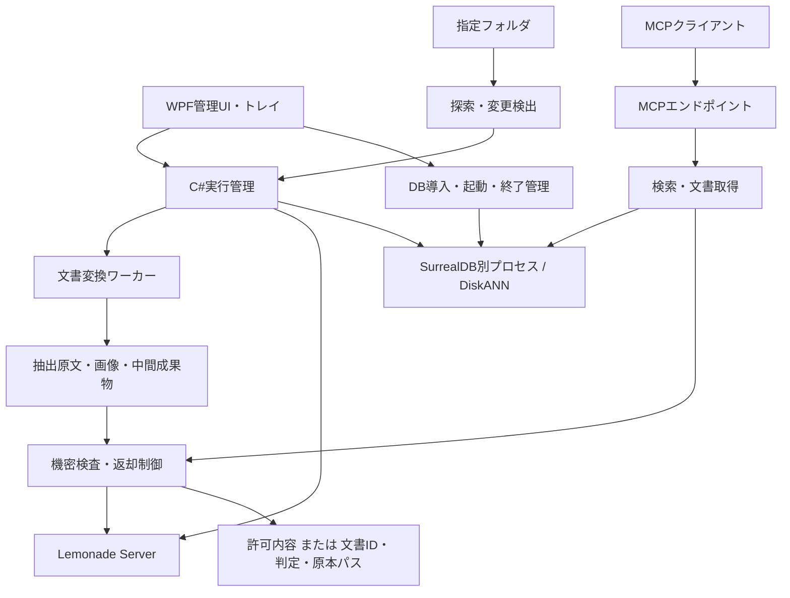

# Local RAG System 設計書

- 作成日: 2026-11-02（日本時間）
- 状態: 基本設計。実装・実機検証に伴う変更は本書と実装計画に反映する。
- 改訂: 同日の追加指示により、SurrealDBを組み込みから別プロセス方式へ変更。
- 対象: Windows 11 / x86_64 / 単一ユーザー
- 初回リリース目標: 0.0.0（テキストファイル・常駐処理・MCP取得）。Word・PDF・音声は後続。
- 関連文書: [実装計画](ImplementationPlan.md)

## 1. 目的と前提

指定されたローカルフォルダ内の文書と音声を継続的に取り込み、ローカルAIによって検索用データを作成する。MCPクライアントから検索・文書全体の取得を行えるようにし、返却直前に機密検査を行う。

想定PCはシステム全体でメモリ32GB、APUを搭載する。対象文書は数百件程度、音声は1ファイル30分～1時間を想定する。処理速度より通常のPC操作への影響を小さくすること、途中終了から復旧できることを重視する。

主言語はC#とし、変換ライブラリなどの依存関係によってPython等を併用する。Microsoft Officeはインストール済みとする。初版はユーザーのログインセッション内で動作し、ログアウト中は処理しない。

本書は将来のWord・PDF・音声対応を含む全体設計を保持する。ただし初回リリース0.0.0は、UTF-8の.txt/.md本文の取り込み、常駐監視、MCPのsearch/fetchによる取得までに限定する。Office、Docling、STTは0.0.0の依存要件に含めない。常駐処理とMCP取得の実機での成功を確認してリリースし、後続形式の完成を待たない。具体的なリリース判定条件と実装順序は実装計画1節を正とする。

## 2. 要件対応

| ID | 要件 | 設計方針 |
|---|---|---|
| R01 | フォルダ探索・更新監視 | 既定5分の定期探索と独立した処理キュー。フォルダ優先度・更新日時順、更新除外は既定10分 |
| R02 | Word・PDF・音声・テキスト | 種別別アダプターと共通工程を組み合わせる |
| R03 | Word・PDFパイプライン | Markdown変換、第一次整形、分類、第二次整形、分割、Embedding |
| R04 | 音声パイプライン | STT、整形、分類、要約、任意分割、Embedding |
| R05 | テキストパイプライン | 分類、整形、分割、Embedding |
| R06 | 最小設定と管理UI | フォルダ・AI接続設定でローカル処理を開始可能。詳細設定には初期値を提供 |
| R07 | MCP・機密検査 | search/fetchの共通返却経路でパターンとローカルLLM検査 |
| R08 | タスクトレイ常駐 | WPFウィンドウを閉じても常駐。終了はトレイから明示 |
| R09 | Lemonade Server | Chat、Embedding、STTを用途別モデルで接続 |
| R10 | 別プロセスのSurrealDB・DiskANN | 未起動なら必要に応じて自動導入・起動。終了時にDBも停止するか設定可能 |
| R11 | C#主体 | UI、スケジューラー、処理状態、検索、検査、MCPはC# |
| R12 | Office Interop利用可 | 旧形式変換等の専用ワーカーとして隔離 |
| R13 | Windows 11 x64 | win-x64を配布・検証対象とする |

## 3. 技術選定と検証境界

| 領域 | 方針 | 検証事項 |
|---|---|---|
| 本体 | .NET 10 LTS / C# | SDK・ランタイムのバージョンを固定 |
| UI | WPF + トレイアイコン | 高DPI、閉じる/再表示/終了、二重起動 |
| DB | SurrealDB 3.3.5 / 別プロセス / SurrealKV | 固定版・SHA-256検証、自動起動、認証、所有プロセスの通常終了 |
| ベクトル | SurrealDB内のDISKANN | 作成、追加、検索、削除、再起動、検索可能になる時点 |
| AI | Lemonade Server | 実際のAPI、ローカルモデル、入力上限、JSON出力、STT時刻 |
| 文書変換 | Python + Doclingを第一候補 | 日本語・表・画像・OCR・オフライン実行 |
| Word互換 | Microsoft.Office.Interop.Word | STA・ダイアログ・タイムアウト・ユーザーのWordへの影響 |
| MCP | 公式C# SDK | Streamable HTTP、認証、対象ChatGPT環境での実呼び出し |

旧構成の`SurrealDb.Embedded.SurrealKv 1.0.0`は内蔵エンジン3.0.5のためDISKANNを利用できなかった。ユーザーの追加指示に従い、公式Windows x64版SurrealDB 3.3.5を別プロセスとして実行し、`SurrealDb.Net 1.0.0`からHTTPで接続する構成へ変更した。HNSWや別DBへの置換は行わない。

実機で自動導入・起動・通常終了、DiskANNの作成・検索・更新・削除、プロセス再起動後のチェックポイントとベクトル検索を確認済み。詳細は[技術検証記録](TechnicalValidation.md)の追補を参照。

## 4. 全体構成

DBデータファイルを開くのはSurrealDBプロセスのみ。常駐アプリはHTTPで接続し、変換ワーカーにはDB接続を渡さない。管理UIとバックグラウンド処理は責務を分離し、UIスレッドで変換・推論・DB待機を行わない。

推奨プロジェクト分割はDomain、Application、Infrastructure、Desktop、Diagnostics、Testsとする。追加の変換ワーカーはworkers配下に置く。初期実装では過剰なプロジェクト分割を避け、責務境界をインターフェースで保つ。

## 5. ライフサイクルと低負荷運転

- ログイン中のユーザー権限で実行し、管理者権限を必須にしない。
- 管理画面を閉じるとトレイへ格納する。終了操作は処理中断と状態保存を行う。
- 取り込みは標準で1件ずつ、AI呼び出しも原則直列とする。
- アプリと所有する変換ワーカーは低優先度で動作する。Lemonade Serverの優先度を無断変更しない。
- 別プロセスの推論負荷は、入力長、同時要求数、呼び出し間隔、モデル常駐数によって抑制する。
- メモリ圧迫、バッテリー駆動、ユーザー操作中などの一時停止条件を設定可能にする。
- 検索と返却前検査は取り込みより優先する。ただし、実行中のモデル要求を安全に中断できるとは仮定しない。
- 同じモデルを利用する処理のまとめ実行は将来の最適化とし、復旧単位を崩さない。

### 5.1 SurrealDBの導入・起動

標準は`127.0.0.1:8000`。ポートは1024～65535から変更でき、変更は再起動後に適用する。固定の専用保存先を使い、既存インストールやPATH上の実行ファイルを上書きしない。

1. アプリの設定を読み、保存先ごとの管理ロックを取得する。
2. ポートが使用中なら、SurrealDBの版と認証を確認して接続する。認証情報がない場合は管理画面で設定できる。別サービスや非対応版であれば自動置換せず、エラーを表示する。
3. 未起動なら`tools/surrealdb/3.3.5/surreal.exe`を確認する。なければ公式GitHub Releaseから取得し、固定SHA-256を照合してから配置する（約307MiB）。不一致・中断時は実行しない。既存ファイルのハッシュも起動前に確認する。
4. 初回はランダムパスワードを生成し、Windows DPAPI CurrentUserで`server/credentials.dpapi`へ保存する。パスワードを設定JSON・コマンドライン・ログに書かない。子プロセス環境で渡す。
5. SurrealDBを非表示の専用コンソール・低優先度で起動する。認証を必須とし、外部向けアドレスで待ち受けない。接続準備が整うまで待ち、タイムアウトを表示する。

初回導入にはインターネット接続が必要。その後は検証済み実行ファイルでオフライン起動可能。自動更新は行わず、更新版は移行・互換性検証後にアプリから指定する。

### 5.2 SurrealDBの終了と所有権

`Database.StopOnExit`の初期値は`true`。画面のチェックを外して保存するとDBを残したままアプリを終了できる。ウィンドウの閉じる操作はトレイ格納なのでDBを停止しない。

起動したDBのPID・起動時刻・実行ファイル絶対パス・ポートを`server/ownership.json`に保存する。次回起動ではこれらを照合して同じプロセスに限り管理を引き継ぐ。名前やポートだけでプロセスを終了しない。ユーザーが独立に起動した既存サーバーは、終了設定がONでも停止対象にしない。

アプリ終了時は処理中断とDB操作完了を待つ。停止設定がONなら、専用補助プロセスが対象の私有コンソールの構成とプロセス同一性を再検証し、CTRL_BREAKを1回だけ通知する。保存・終了を待ち、失敗時に強制終了や2回目の通知へ切り替えない（2回目の通知はサーバー側で強制終了になり得る）。失敗時はアプリを開いたままにして再確認を可能にする。DBを残す設定へ変更することもできる。

異常終了時は次回起動で所有権を照合する。DBが残存していて応答しない場合は二重起動しない。旧組み込みDBの試験ファイルは保持し、新しい`server/data`へ無断変換しない。旧DBからの自動移行は未実装。

## 6. フォルダ探索と更新判定

### 6.1 周期の定義

初期チェック間隔は5分。チェック開始を基準とする定期探索と、1ファイルずつ実行する処理ワーカーを分離する。AI処理中も定期探索して待ち行列を更新する。探索自体は重複させず、長い探索・スリープで逃したチェックは集約する。詳細は26節を参照。

ファイル単位の再試行は有限回とする。上限到達時は失敗・保留として周期を完了できる。設定不備など全体障害でもビジーループせず、間隔を置いて再試行する。

手動実行要求は集約する。起動時は保存済み未完了ジョブを回復してから探索を行う。スリープ復帰時は経過した周期をすべて再現せず、必要な1回だけを実行する。一時停止中は新規処理を開始しない。

### 6.2 検出規則

フォルダごとに再帰探索、対象拡張子、除外パターンを持つ。標準ではOffice一時ファイル、アプリ自身の保存領域、シンボリックリンクやジャンクションを除外する。重複する監視ルートは正規化して同じファイルを重複処理しない。

パス、サイズ、更新日時で候補を抽出し、処理前にSHA-256等で内容を識別する。処理用スナップショット取得前後のサイズ・更新日時を確認し、途中変更時は再取得する。低頻度の全件ハッシュ照合で同一メタデータの変更を補う。

内容を読めない、書き込み中、アクセス拒否、暗号化文書などは明示的に保留する。アクセスできないフォルダを空と見なして削除処理しない。削除は正常に完了した探索範囲についてだけ判定する。

### 6.3 公開状態

変更または削除を検出した旧版は検索対象から外す。新版は全工程とインデックスの準備が完了してから公開する。再処理失敗中に旧版を自動復活させない。名前変更の同一性が確定できない場合は、削除＋新規として安全に処理する。

## 7. 共通パイプライン

| 対象 | 標準の工程順 |
|---|---|
| Word / PDF | 変換 → 第一次整形 → 分類 → 第二次整形 → 意味チャンク分割 → Embedding |
| 音声 | STT → 整形 → 分類 → 要約 → 任意チャンク分割（初期値OFF）→ Embedding |
| テキスト | 分類 → 整形 → 意味チャンク分割 → Embedding |

工程ごとにenabled、prompt_version、model_profile、input_limit、timeout、retry_policyを持つ。分類別工程には継承/有効/無効を設定できる。省略工程は入力をそのまま次工程へ渡す。

分類を無効化した場合は既定分類に進む。分類不明は既定分類または保留とし、自動的に対象外にしない。対象外分類はEmbeddingと検索公開を行わない。機密検査とは別の決定である。

ユーザー記述の「整形、分類、省略の処理を省略」は、音声では整形・分類・要約を個別に省略可能という意味で扱う。

### 7.1 分類とプロンプト

分類には不変ID、表示名、説明、処理設定、除外フラグを持つ。初期分類は一般文書、仕様・設計、手順書、議事録、対象外とする。追加、名称変更、プロンプト変更、手動分類を認める。

プロンプトはシステム同梱版とユーザー変更版を分け、履歴・復元・サンプル実行・差分確認を提供する。利用可能な変数と応答形式は検証し、任意コードの実行には使わない。

ジョブ開始時の設定スナップショットを固定する。変更時には影響する工程以降を再実行する。分類の除外指定や機密ルールの変更は、検索返却の可否に即時反映する。

### 7.2 LLMの出力検証

文書内容は命令ではなく入力データとして渡し、LLMにファイル操作やツール実行を許可しない。分類は許可済み分類IDのみ、分割は実在する段落IDと順序のみ受け付ける。

チャンク本文をLLMに再生成させず、段落範囲の指定からC#で切り出す。範囲の欠落、重複、逆転、入力上限を検証する。整形は可能な限り修正差分と削除対象で表し、数値・否定・固有名詞の変更や大量削除を検知して保留できるようにする。

長文処理は見出し、ページ、段落等で入力を分ける。黙って切り捨てない。JSON形式対応は接続テストで確認し、構文不正時は有限回再試行後に保留する。

## 8. ファイル種別ごとの処理

### 8.1 Word・PDF

Doclingを別プロセスから実行し、Markdownと構造化抽出データを生成する。段落・表・画像ID、PDFのページ番号、抽出可能な位置情報を保持する。存在しないWordページ番号を推測して付与しない。

抽出原文は整形前に保存する。ヘッダー・フッターを検索用本文から取り除いても、機密表示等の根拠を保持する。スキャンPDFにはローカルOCRを使用し、抽出失敗を空文書として正常終了させない。

画像は埋め込みMarkdownに対応する。保存時は画像を独立した資産として管理し、必要時に埋め込みMarkdownを再構成してもよい。テキストLLMやEmbeddingにはBase64を入力せず、画像ID、キャプション、OCRテキストを使う。画像の視覚的意味の検索は将来拡張とする。

旧.doc等の互換性対応にはWord Interopワーカーを使える。STA・直列実行、マクロ無効化、外部リンク更新抑止、読み取り専用、タイムアウトを必須とする。ユーザーが起動したWordを終了しない。失敗時に本体を巻き込まない。

### 8.2 音声

原音声、文字起こし原文、整形結果、要約を別々に保持する。要約に根拠となる発言区間を対応付ける。話者や時刻はバックエンドから検証可能な情報が得られる場合だけ記録する。

STT入力の音声分割とRAG用テキストのチャンク分割は別設定。30分～1時間の入力を部分的に再開できるようにする。標準の検索対象は要約であり、後から文字起こし全文も対象に追加可能な構造にする。

RAG用分割OFFでEmbedding上限を超えた場合は、入力上限超過で保留する。短い要約への再生成、意味分割ON、長文時のみ機械分割をユーザーが選べる。既定で勝手に分割・切り捨てしない。

### 8.3 テキスト

0.0.0はUTF-8（BOM可）の.txt/.md本文を対象とする。後続の候補は.csv/.tsv/.json/.yaml/.yml/.xml/.html/.htm/.log。実装済み形式と予定形式をUIで区別する。CP932の明示指定は後続対応とし、復号エラーを置換文字で隠さない。

HTMLはスクリプトを実行せず、外部資源を取得しない。CSV列名、JSONキー、コード構造等は種別別に保持する。未知のバイナリをテキスト扱いしない。

## 9. AI接続

Chat、Embedding、STTのプロファイルを分離する。Lemonadeの接続先と各モデルを選択し、短いテスト要求で機能・返却形式・次元数を確認する。

標準接続先はループバックとし、ローカル実行モデルのみを使用する。Lemonadeがクラウドモデルを公開できることに注意し、クラウド転送設定を検出・拒否する。判別できない場合は確認待ちとし、ローカル推論を検証済みと表示しない。

APU型番と実測が得られるまで具体的なモデルサイズ、速度、最大常駐メモリを保証しない。接続失敗、モデル未導入、VRAM/メモリ不足は別の状態として表示する。

Embeddingの空間IDはモデル識別子・版・次元数・前処理・距離尺度を含む。同じ次元でもモデルが異なれば混在させない。モデル変更時は新世代を構築し、検索側モデルも対応する世代へ切り替える。

準備済みモデルは`Qwen3-Embedding-0.6B-GGUF`（ローカルllamacpp、Q8_0）。実際のEmbedding API応答は1,024次元。バッチ件数、入力との対応位置、次元一致、有限数値、非ゼロを検証する。固定例文の実EmbeddingをDiskANNに保存し、同じベクトルで取得できることを確認済み。日本語検索品質、長文の入力限界、検索用instructionの選定は後続のP1で評価する。

## 10. データモデル・成果物・復旧

| エンティティ | 主な情報 |
|---|---|
| watched_folder | ルート、探索・除外設定 |
| document | 不透明ID、パス、種別、公開状態 |
| document_revision | 内容ハッシュ、抽出結果、設定スナップショット |
| job / stage_run | 工程、状態、試行数、所有権、開始・完了、成果物参照 |
| artifact | 種別、相対保存先、ハッシュ、サイズ、元文書の版 |
| category / prompt / pipeline | 不変ID、版、定義 |
| chunk | 文書版、範囲、本文、検索世代、ベクトル |
| disclosure_decision | 内容ハッシュ、ポリシー版、モデル版、判定、有効期限 |
| scheduler_state | 周期の状態、最終完了時刻、次回実行時刻 |

標準保存先はユーザーのLocalApplicationData配下のLocalRAG。DB、artifacts、設定、ログを分離する。設定ファイルには接続先等を保存できるが、文書・ジョブの正本を一時的なインメモリリストに置かない。認証情報はWindowsの保護機能で保存する。

成果物を一時名で書き、ハッシュ確認と置き換え後にDB工程を完了にする。公開版の参照はトランザクション等で切り替え、検索可能性を確認してから有効にする。

クラッシュで実行中のまま残った工程は回復対象。永続化済みかつ整合性を確認できる工程だけ再利用する。古い実行者が新しい結果を上書きしないよう、実行世代・リース等で所有権を確認する。再実行でチャンクが二重登録されないキー設計とする。

孤立した成果物や旧世代は保持期間に従って回収する。バックアップはDBと成果物の整合する世代で取得し、まず停止状態でのバックアップ/復元を実装する。スキーマ移行前に復旧可能なバックアップを作る。

## 11. 検索・全文取得

検索クエリを対象検索世代と同じモデルでEmbeddingし、DiskANNで候補を取得する。公開中の文書版、監視範囲、許可フィルターに限定する。候補を機密検査後に返す。フィルターによる候補不足を考慮して上限付き追加取得を認める。

全文はWord/PDFでは抽出Markdown全体、音声では文字起こし全文と定義する。整形版・要約版はrepresentationを明示して選択する。原本バイナリのダウンロードは初版のMCPには含めない。

大きな文書はページングし、cursorを文書版・表現・機密ポリシー版に結び付ける。最初のページを返す前に文書全体を検査する。引用には実在する出典情報だけを付ける。文書内容の未検査ストリーミングは行わない。

## 12. 機密検査

### 12.1 標準ポリシー

パターンとローカルLLMの両方を有効とし、全検査が許可した内容だけ返す。パターンにはリテラル/正規表現、対象範囲、説明、enabledを設定できる。正規表現にはタイムアウトを設ける。

判定対象は抽出原文、機密表示等の構造情報、実際の返却候補。検索用整形で消えた文字も検査する。長文は全範囲を分割検査し、一部でも拒否または判定不能なら文書全体の本文を返さない。

画像を返す場合も検査範囲に含める。OCRだけで画像のあらゆる機密性を判断できるとは仮定せず、必要な検査が未対応なら画像を含む全文表現は返却不可とする。テキストのみの表現を返す場合は画像省略を明示する。

### 12.2 外部応答

| 状態 | 応答 |
|---|---|
| 許可 | 検査済み本文と許可済み出典情報 |
| 拒否 | 文書ID、decision=withheld、source=原本のフルパス。本文なし |
| 検査失敗/判定不能 | 文書ID、decision=pending、原本パス。本文なし。機密であるとの断定はしない。MCP呼び出し全体のタイムアウトは固定エラーのみ |
| 検査無効 | 検査を省略して返す。UIに無効状態を明示 |

拒否・保留でも、ユーザー自身が原本を開くために実パスを返す（2026-11-05仕様変更）。パスに含まれるファイル名・フォルダ名はクライアントへ伝わる。本文由来のタイトル、抜粋、要約、コード、詳細判定理由は返さない。AIにパスから本文を読み出す許可は与えない。検索対象外・変更済み・削除済みの文書はパス通知の対象にも含めない。

キャッシュキーには原文・返却内容のハッシュ、文書版、パターン版、プロンプト版、モデル版を含める。ルール変更時は即時失効させる。本文を外へ出せる経路はすべて同じ検査を通す。

ユーザーによる変更・無効化を認める。将来は設定の出所と管理者優先を導入できる構造とする。LLM検査は完全な漏えい防止を保証せず、既知の機密サンプルと回帰テストで検出特性を評価する。

## 13. MCPとChatGPT接続

読み取り専用のsearch(query, limit, filters)とfetch(document_id, revision, representation, cursor)を公開する。limitや返却サイズを制限し、任意パスや任意SQLを受け取らない。設定変更・インデックス削除をMCPに公開しない。

0.0.0では公式C# SDK 2.3.0によるStreamable HTTPをアプリ内で起動し、ローカルクライアントとデスクトッププラグイン用にstdio中継を同梱する。HTTPは127.0.0.1限定、DPAPIで保護したランダムBearer認証、Host検証、Origin付き要求の拒否を行う。stdioではstdoutにログを混ぜない。詳細は[MCPConnection.md](MCPConnection.md)を参照。

初版で実装する引数はsearch(query, limit=5)とfetch(id)に限定する。fetchは原文の現在公開版全文を返す。上記のfilters、revision、representation、cursorは将来拡張であり、0.0.0には含めない。返却前の原文照合・機密検査は管理画面と同じサービスで実施する。設定変更時・終了時はリスナーを止め、進行中の呼び出しの取消・完了後にサービスとDB参照を破棄する。

ChatGPT Business内での利用を前提とし、Windowsデスクトップのローカルstdioプラグインを優先する。API Platform、APIキー、Secure MCP Tunnelを必須にしない。ブラウザ版も利用要望があるため、認証付きHTTPS MCPの接続経路を後続で設計する。ローカルプラグインの登録成功だけでChatGPTからの実取得成功とは扱わない。

ローカルエンドポイントはループバックに限定し、接続元認証と許可範囲を設計する。外部接続時も利用者の識別を維持し、機密検査を認証の代わりにしない。未認証の公開エンドポイントを自動起動しない。

解析・索引作成はローカル。MCPで返した許可内容はChatGPT側に送られる。「フォルダとAI接続だけで動く」の範囲はローカル処理と管理画面の検索までであり、ChatGPT接続には追加設定が必要である。

## 14. 管理UI

初期設定は監視フォルダとAI接続を中心にする。詳細設定には既定値を提供する。未実装の項目を設定可能に見せず、予定機能と明示する。

| 画面 | 主な機能 |
|---|---|
| ダッシュボード | 稼働状態、処理中、待機、失敗・保留、次回探索 |
| フォルダ | 追加・削除・再帰・拡張子・除外 |
| AI接続 | 用途別モデル、ローカル性と機能の検証 |
| DB | ポート、自動導入・起動状態、アプリ終了時の停止設定、既存サーバーの認証設定 |
| 文書 | 版、分類、成果物、公開状態、再処理 |
| パイプライン・分類 | 工程設定、分岐、除外、手動分類 |
| プロンプト | 編集、履歴、復元、サンプル比較 |
| 機密検査 | パターン、プロンプト、有効化、判定テスト |
| MCP | 接続方式、認証、疎通結果 |
| 運用 | 低負荷設定、保存期間、バックアップ・復元 |

## 15. 品質と受入条件

- 定期チェックはAI処理完了を待たず、探索同士・ファイル処理同士は重複しない。高優先度の待ち仕事を挿入しても実行中ファイルを中断しない。
- アクセスできないフォルダを削除と誤認しない。
- 変更/削除済み・対象外・未公開の文書を検索結果に含めない。
- 工程途中の強制終了後に整合性を回復でき、完了工程を必要以上に再実行しない。
- モデル・プロンプト変更時に必要な範囲だけ再処理し、異なるEmbedding空間を混在させない。
- ヘッダーから機密表示を除去しても、外部返却の判定に残る。
- 検査失敗、不正JSON、未検査画像、古い許可キャッシュから本文が漏れない。
- 30分～1時間の音声と代表的な日本語Word/PDFで成果物と出典を検査する。
- 通常操作への影響は実測する。具体的な速度・メモリ合格値はAPU型番と代表データを確認して設定する。
- 実際のChatGPTからsearch/fetchが成功した証拠が得られるまで接続済みと報告しない。

## 16. 未確定事項

1. APU型番、最終的なLLM・STTモデルとEmbeddingの日本語検索品質。
2. ChatGPT Businessデスクトップでの実取得、ブラウザ版向け接続経路と認証方式。
3. 変換ツールの正確な版と配布方式、SurrealDBの将来の更新・移行方式。
4. 画像の返却に必要な検査方式、初版で対応する画像表現の範囲。
5. 旧形式や暗号化文書など、初版の対応拡張子の最終範囲。
6. データ保持期間、インストーラー、コード署名、バックアップ先。

## 17. 参照資料

2026-11-02に設計検討で参照。製品仕様は採用バージョンで再検証する。

- [.NET support policy](https://dotnet.microsoft.com/en-us/platform/support/policy/dotnet-core)
- [SurrealDB .NET SDK](https://github.com/surrealdb/surrealdb.net)
- [SurrealDB 3.3.5 release](https://github.com/surrealdb/surrealdb/releases/tag/v3.3.5)
- [SurrealDB .NET接続設定](https://surrealdb.com/docs/reference/dotnet/core/create-a-new-connection)
- [SurrealDB vector indexes](https://surrealdb.com/docs/learn/data-models/vector-search/vector-indexes)
- [Lemonade API](https://lemonade-server.ai/docs/api/openai/)
- [Docling supported formats](https://docling-project.github.io/docling/usage/supported_formats/)
- [Docling CLI](https://docling-project.github.io/docling/reference/cli/)
- [Office unattended automation](https://learn.microsoft.com/en-us/office/client-developer/integration/considerations-unattended-automation-office-microsoft-365-for-unattended-rpa)
- [MCP C# SDK](https://github.com/modelcontextprotocol/csharp-sdk)
- [ChatGPT custom MCP](https://developers.openai.com/api/docs/guides/custom-mcp-server)
- [Desktop-only plugins](https://developers.openai.com/plugins/deploy/desktop-only)

## 18. 最小テキストRAGの実装仕様（2026-11-02）

前節までの完成形に対し、P1では以下の範囲を実装した。Word/PDF/音声は未実装。MCPは後続の0.0.0作業でsearch/fetchとstdio中継を追加した。設定保存・入力エラー・再起動・終了等はユーザー許可後に画面操作を検証した。検証範囲とモデル別の結果はTechnicalValidation.mdに記録する。

### 18.1 入力・処理・返却

- 対象はUTF-8の.txt/.md。BOM可、最大256KiB、文書の既定上限6,000文字。リンク・ジャンクションをたどらず、アプリ保存先を探索から除外する。
- 空行区切りの段落にIDを付ける。分類後、LLMが指定した不要段落IDを除去する。本文の書き換えは行わず、削除量が本文の半分を超えるなど不正な応答は保留する。
- 分割はLLMが連続する段落範囲を指定し、アプリが原文から組み立てる。重複・欠落・架空IDを拒否し、既定1,200文字以内とする。大きな単一段落は自動切り捨てせず保留する。
- 分類を省略すると既定分類を使う。整形・分割は全体と分類別に省略できる。分類別の除外はEmbeddingしない。分割省略時もEmbedding入力上限は守る。
- JSONの構造と値を検証し、不正応答の再試行は1回まで。出力の文章部分から都合のよいJSONだけを抜き出さない。
- 既定5分で定期チェックする。自動監視の一時停止と手動1回実行を備える。探索はAI処理と独立し、取り込みと検索はファイル単位で同じAI実行枠を使う。
- 取得は文書IDを指定し、原文を返す。検索・全文取得とも原文と返却候補（出典を含む）に機密検査を行う。拒否・保留時は文書ID・判定・原本パスを返し、本文・段落範囲は返さない。
- LLM機密検査は原文全体を重なりのある小区間で確認する。パターン一致、モデルの拒否、曖昧な応答、検査失敗を許可扱いにしない。機密検査OFFは未検査として区別する。
- 管理画面の結果は文字列表示とし、Markdown画像やHTMLを実行・取得しない。画像抽出・画像の機密検査は未対応。

### 18.2 設定

フォルダとLemonade接続先・チャットモデル・Embeddingモデルを指定すれば、既定プロンプトと分類で処理できる。下表は旧設定との対応を示す。現行の編集方法は22節の管理画面とし、JSONの直接編集を要求しない。

| 設定 | 既定値・意味 |
|---|---|
| AutomaticMonitoring | true。起動・設定反映後に自動監視 |
| TextPipeline.ClassifyEnabled / FormatEnabled / ChunkEnabled | true。工程の有効化 |
| TextPipeline.DefaultCategory | general。分類省略時に適用 |
| TextPipeline.Categories | general / specification / procedure / meeting / excluded。追加・説明・除外・工程上書き・プロンプト上書きを編集可能 |
| TextPipeline.MaxDocumentCharacters / MaxChunkCharacters | 6000 / 1200。これとは別に実行モデルの入力上限を検査 |
| TextPipeline.MaxOutputTokens | 512。構造化応答の出力予約 |
| TextPipeline.EmbeddingRevision | 1。同じモデルIDの重みを入れ替えた場合、ユーザーが版を更新する |
| TextPipeline.*Prompt | 分類・整形・分割・機密検査のプロンプト |
| Confidentiality | 機密検査の有効化、パターン等 |

既定excluded分類は原文に「検索対象外」と明示されたものを対象にする。機密表示があるだけでは分類による除外とせず、返却時の機密検査に委ねる。ユーザーは分類・プロンプトを変更できる。

Lemonadeから実行時context_lengthを取得する。未ロードで不明な場合、ローカル導入済みと確認できたモデルだけをロードして再確認する。モデルのダウンロードやコンテキスト設定変更は行わない。UTF-8バイト数、出力予約、余裕分により保守的に入力を検査し、上限不明・超過時は保留する。

モデル変更への対応として、nomic-embed-text-v2-moeでは文書に`search_document: `、検索語に`search_query: `を付ける。入力上限は実行時値とモデル公称512トークンの小さい方とする。既存のQwen形式とは入力プロファイルを分離し、設定・空間の識別に含める。入力前処理の変更後は既存索引を混用せず再取り込みする。

Gemmaのryzenai-llm構成では、別systemメッセージの指示が期待どおり反映されなかった実測に基づき、指示と区切り付きの文書データをuserメッセージにまとめる。JSONは字下げなしの1行形式を求める。Gemmaに限らず、分割指示には実際の残存段落IDと先頭・末尾IDを明示する。応答の形式・範囲検査は緩めず、再試行しても不正な場合は保留する。

### 18.3 保存・版管理・回復

`text_document`に現行状態、`text_revision`に版のチェックポイント、`text_space`にEmbedding空間情報を保存する。空間ごとの`text_vectors_<ハッシュ>`テーブルにDiskANN（F32、COSINE）を作成する。

文書はパスから識別し、内容のSHA-256と工程別の実効設定・入出力ハッシュで再利用可否を決める。新しい処理試行には独立した版IDを発行し、途中再開時は同じ版を使用する。Embedding空間は接続先、モデルID、明示版、モデル固有の入力プロファイル、次元、前処理版、距離関数で分離する。機密設定だけの変更で再Embeddingはしない。工程情報・移行・公開条件は[設定変更と工程単位の再処理](IncrementalReprocessing.md)に定める。

分類、整形、分割、各Embeddingの完了を保存する。同じ原文・設定の再試行では完了済み工程を再利用する。新しいチャンクは非公開で保存し、全件完了後に現行参照と有効化をトランザクションで切り替える。エラーは例外型・工程・固定の理由コードを記録し、モデル応答本文や任意の例外メッセージを通常ログに残さない。

更新検出時は旧版を非公開にする。削除判定は探索を完了できた監視先だけで行う。検索では有効版・設定をフィルターし、返却前に監視対象・原文ハッシュを検査、機密検査後にも再確認する。読み取れない・変更された原文の旧版は返さない。

設定反映時には進行中の処理をキャンセルして終了を待ち、旧検索表示を消去する。終了時も処理の停止後にDBの終了方針を適用する。通常キャンセルとDB正常再起動後の再開を検証済み。監視の完了時刻の永続化は19節のとおり実装。強制終了・実機スリープ復帰・検索優先制御・旧版回収は引き続き実装・検証する。

## 19. 監視の完了時刻と再起動（2026-11-02、旧方式の記録）

この節は当時の完了基準方式の記録である。2026-11-03からは26節の開始基準の定期チェックへ変更し、旧形式は読み込み後に即時チェックする。

SurrealDBの`text_monitor:current`に監視対象の識別子、実行中フラグ、UTC完了時刻、保存形式の版を記録する。識別子はパイプライン設定版と、正規化して並べ替えた監視フォルダ・再帰設定から生成する。監視間隔・自動監視ON/OFFは識別子に含めない。

周期の開始前に実行中を保存し、周期が終了した後に完了時刻を保存する。文書単位の失敗を含む終了、周期全体の例外による終了も完了後待機の対象とする。キャンセル時は実行中の記録を残す。手動実行も同じ記録を更新し、文書ごとの途中工程は既存のチェックポイントから回復する。

| 再開時の状態 | 動作 |
|---|---|
| 記録なし、設定・フォルダの変更 | 直ちに探索 |
| 前回実行中のまま | 直ちに探索し、未完了工程を再開 |
| 完了後、監視間隔未満 | 残り時間を待機 |
| 完了後、監視間隔以上 | 1周期だけ開始し、経過した周期数をまとめて再実行しない |
| 間隔のみ変更 | 前回完了から新しい間隔を適用 |
| 監視記録の読み書きに失敗・不正な記録 | 自動監視を停止し、画面で通知 |

待機は最大30秒ごとにUTCを再確認する。時計が進んだ場合は期限を再評価し、時計が戻った場合は残り時間を引き継ぐ。未来の完了時刻を読み戻した場合でも待機は1間隔を超えて延長しない。これによりスリープ後に過去の周期を大量に繰り返すことを防ぐ。時刻変化は擬似時計で検証済みだが、実機でのスリープ・復帰試験は別途行う。

待機中も文書一覧と検索は利用できる。次回予定時刻を表示する。自動監視を一時停止すれば手動で即時実行できる。今回の追加UIはビルド検証までで、実操作は都度許可後に行う。

## 20. 分割応答例と工程別エラー（2026-11-02）

固定の段落1～2を例示すると、1段落しかない入力でもGemmaが例の終端2を返すことを再現した。標準プロンプトから固定IDの例を除き、実入力の段落IDと文字数上限（空行の2文字を含む）から完全な有効応答例を生成して補足する。分類ごとの意味的な境界選択は引き続きLLMへ依頼する。1段落の場合もChunkEnabledが有効ならLLMを呼び出し、実際の応答に対するID・網羅性・文字数検査を省略しない。

保存済み設定のプロンプトが旧標準文字列と完全一致する場合のみ、実行時に新標準へ置き換える。分類別プロンプトにも同じ判定を適用する。独自プロンプトを黙って書き換えず、入力に合う応答例と制約を追加する。処理の識別を`text-pipeline-v3`へ更新し、旧処理版の完成済み索引・途中工程を混用しない。v3内の同じ原文・設定の失敗再試行では完了済み工程を再利用する。

文書状態にnullableの`ErrorStage`と`ErrorDetailCode`を追加する。読み取り・処理準備・分類・整形・分割・埋め込み・公開の各工程を識別し、分割の順序、終端、上限、未網羅を固定コードにする。モデル出力の未完了とチャット入力上限も区別する。UIはコードから固定日本語へ変換し、未知の値をそのまま表示しない。再試行開始・公開成功時はエラー情報を消去する。旧レコードの追加フィールド未存在はnullとして読み込む。

診断CLIの`chunk-probe`と`chunk-smoke`だけが固定合成入力の応答を保存する。ユーザー文書を診断入力として受け取らず、通常の取り込み経路にはモデル本文の保存を追加しない。

## 21. コードによる補正とLLMへの差し戻し（2026-11-02、現行方針）

ローカルLLMの構造化応答は誤りを含む前提で扱う。20節の「単一段落でもLLMを呼ぶ」方針を改め、判断の余地がない処理はコードで確定する。既存の分類・整形・分割・機密検査の構造化応答に以下を適用する。今後の変換・音声パイプラインでも、工程ごとのスキーマと不変条件を明示して同じ方針を適用する。

| 状態 | 対応 |
|---|---|
| 1段落、上限内、段落境界で全内容を網羅する契約 | 選べる範囲が一意なので、実ID～実IDの1チャンクをコードで生成。LLMを呼ばず原文を保持 |
| 段落IDが数値ではなくASCII整数文字列 | 32bit整数で表せる0～9のみの文字列を数値化し、その後にIDの存在・順序等を検証 |
| 削除対象の同一IDが複数ある | 集合として重複を除去し、存在検査・削除量検査を続行 |
| 完全なJSONコードフェンス | フェンスだけ除去して通常のJSON検証を行う |
| 構文・必須項目・型・重複キーが不正 | 固定の検証理由と原入力を使い、完全なJSONの再生成を依頼 |
| 分類が未定義、削除IDが存在しない、削除量が過大 | 分類IDの制約・削除IDの制約・過剰削除の理由を伝えて再生成。コードが意味を推測して分類・削除内容を変更しない |
| 分割範囲の順序・終端・網羅性・文字数が不正 | 失敗した制約を伝えて再生成。IDを丸めたり、範囲の欠落を勝手に補ったり、本文を切り捨てたりしない |
| 機密判定が有効なwithhold/pending | 再試行して許可を求めず、そのまま非返却 |
| 機密判定の形式・判定値が不正 | スキーマ修正を依頼。再び不正ならゲートでPendingとし本文・出典なし |
| 接続障害、モデル設定不正、入力上限超過 | 応答の書き直しでは解消しないため、JSON再生成の対象にしない |

再生成は1工程につき最大1回（初回を含め最大2回）。補正・再生成後は同じ検証を通す。重複キーは入れ子を含めて拒否し、どちらの値が正しいか推測しない。再生成指示へモデル出力や任意の例外文をそのまま差し込まず、アプリが生成した固定の理由だけを追加する。文字列からの数字の抜き出し、小数の丸め、未知の分類の自動選択、拒否から許可への変更は補正に含めない。

処理識別は`text-pipeline-v4`。旧版の索引は再取り込みする。診断の`chunk-repair-probe`では不正応答を注入し、その後の実LLMによる訂正を検証する。注入した不正応答と実モデルの出力を区別して記録する。

## 22. プロンプト・カテゴリ・取り込み/取得設定の分離（2026-11-02）

テキスト版の設定はWPFの4タブで編集する。分類・フォーマット・チャンク・検索に加え、取得時の秘匿判定用プロンプトも管理対象とする。標準プロンプトはコード内の不変レコードから提供し、設定ファイルから上書きしない。ユーザーは標準/既存のコピーまたは白紙から作成し、名前・用途・本文を保存する。使用中のプロンプトとカテゴリの削除は参照解消まで拒否する。

カテゴリは不変ID、編集可能な名前、任意の説明、除外フラグを持つ。カテゴリ名・説明を分類器に渡す。追加したカテゴリは各ルートで明示的に有効化し、分類結果がその候補集合に含まれることを検証する。

`Management.TextExtensions`で対象のUTF-8テキスト拡張子を宣言する。`DefaultTextRoute`を共通設定とし、`ExtensionRoutes`に完全一致する拡張子の設定があれば優先する（大文字小文字は区別しない）。個別設定は追加時に共通設定をコピーし、その後は独立して編集する。各ルートは分類ON/OFF、分類用プロンプト、有効カテゴリ集合、分類OFF時のカテゴリ、整形/分割の既定処理を持つ。カテゴリ別処理は、参照なし=nullで継承、空文字で省略、プロンプトIDで上書きとする。内部表現をユーザーに入力させない。

`Management.Retrieval`は取り込みのルートから独立し、秘匿機能全体・パターン検査・LLM検査のON/OFF、パターン集合、秘匿判定用プロンプトを保持する。メディア・カテゴリ別の分岐は持たず、検索/全文取得と管理画面/MCPに同じDisclosureGateを適用する。将来のWord/PDF/音声もこの返却制御を共有する。検索指示のプロンプトと編集設定は廃止し、nomic-v2の専用接頭辞などのモデル入力形式は自動適用する。従来の指示対応モデルでは既定指示を固定で使う。古い検索設定は読み込み時に除外し、保存時に削除する。

保存形式はSchemaVersion=2。旧形式1と、管理設定を持たない設定は読込時に変換する。旧設定の独自プロンプト（無効工程のものも含む）、工程省略、カテゴリ別上書き、秘匿設定を保持する。読込だけでファイルを更新せず、ユーザーが保存したときに形式2を永続化する。旧版への自動逆変換は行わない。

取り込み設定の適合判定は、文書の拡張子・選択カテゴリで解決した実効設定から生成する。未使用プロンプト、別拡張子、検索・秘匿設定の変更は対象文書の再Embeddingを要求しない。影響を受ける文書だけ旧版を非公開にし、工程別の保存結果を再利用して再処理する。保存時は形式・用途・参照・重複・正規表現を検証する。旧JSON編集欄は管理画面から除去する。

この変更は入力長の制約を解除しない。実文書の分類入力とEmbeddingチャンクがモデル上限に収まるよう、長文の段階処理とモデルに合わせた分割を別途改善する。

## 23. 小さいコンテキストでの長文処理（2026-11-03）

文書上限と1回のモデル入力上限を分離する。新規設定の文書上限は64,000文字、設定可能な最大値は262,144文字。ファイル容量は256KiBのままとし、既存の文書上限値を自動変更しない。処理版は`text-pipeline-v5-bounded`へ更新し、以前の索引を再処理する。

### 入力予算

Lemonadeの実行時context_lengthから、実際に送信する指示・Gemma用のデータ区切り・JSON指示・出力予約・256の余裕分を差し引く。本文だけの文字数ではなく、エスケープを含むJSON入力のUTF-8バイト数で収まることを確認する。各構造化応答は短いID/判定列のみで、出力予約は設定上限と128の小さい方。差し戻し用に160バイトを先に確保し、詳細な検証理由が収まらないときは固定の短いエラーコード指示を使う。実際の送信直前にも同じ制約を検査する。プロンプトや有効カテゴリ自体が収まらない場合は、無断で切り捨てず設定の短縮を求める。

上限不明時やローカルモデルと確認できない場合の拒否は維持する。実際のトークナイザーを実行する方式ではないため、UTF-8バイト数に基づく検査は保守的であり、上限までの効率的な利用を保証しない。

### 工程ごとの分割と集約

| 工程 | 処理 |
|---|---|
| 分類 | JSONとカテゴリ集合が収まる最大区間へ分割し、全区間を検査。区間文字数で重み付けし過半数の非除外カテゴリを採用。除外カテゴリは全区間一致の場合のみ。競合はcategory_conflictで保留 |
| 整形 | 最大8段落かつ入力予算内の組で不要段落を検査。1段落全体が収まらなければその段落を保持。部分だけを見て原段落を除去しない |
| 意味的な分割 | 最大4段落かつ指示・応答例・本文が収まる組でLLMへ依頼。1段落だけの組は結果が一意なのでコードで処理 |
| 物理的な分割 | 文書用接頭辞を引いたEmbedding入力上限と文字数上限に合わせ、原文の部分文字列をコードで生成。長い段落や、分割OFF時の本文も対象 |
| 秘匿検査 | 原文と返却候補を入力予算内の区間へ分割し、短い重なりを付けて逐次検査。要約してから検査しない。拒否・保留・例外は本文の非開示 |

`TextWindows`はUnicodeスカラー値の境界を維持して最大範囲を探索し、近い改行・句点等があればそこで分ける。文字の削除、補完、置換はしない。分割した原段落の断片を連結すると、その段落の原文へ戻る。LLMが指定する段落範囲は従来どおり全段落を1回ずつ網羅する検査を通す。1つの範囲をさらに分割した場合、各断片の出典段落範囲は元の範囲を保持する。全文取得は加工済みチャンクではなく保存した原文を返す。

### 弱いモデルの不正応答と再開

構造検査と1回の差し戻しは維持する。整形・分割の応答が再試行後も不正なら、その応答を一切採用しない。整形は対象段落を保持、分割は各段落からコードで断片を生成して続行する。意味や内容の推測による修復ではない。分類、秘匿判定、通信エラー、入力設定不正、キャンセルにこの代替を適用しない。

代替処理は`ProcessingNotices`へ固定コードを保存し、管理画面の文書一覧に表示する。整形・分割・各Embeddingの完了チェックポイントは維持する。工程中の個々の小区間の結果はまだ永続化しないため、分類・整形の途中で終了した場合はその工程の先頭から再実行する。完成済みの分割結果とEmbedding途中位置は再利用する。

2048/4096はHTTP送信内容を検査する再現テストで確認する。実モデルの意味的分類精度や、コンテキストを実際に2048へ変更した端末での受入とは区別する。

## 24. LLMによる機密判断の試験的位置付け（2026-11-03）

ユーザー指定により、ローカルLLMによる機密判断はexperimentalとして保持し、既定をOFFへ変更する。秘匿機能全体と一致パターン検査の既定ONは維持する。管理画面の選択欄と現在の検査状態に「試験的」を表示する。標準プロンプト・選択・有効化の機能は残す。

`ConfidentialityPolicy.LlmEnabled`と`RetrievalPipelineSettings.LlmEnabled`の初期値をfalseとする。新規設定、および当該項目を省略した設定に適用する。保存済みの明示的なtrue/falseは移行・再読込時も維持し、一律に書き換えない。取得側の設定なので再索引は不要。

既定ではパターン不一致ならLLMを呼ばずAllowedとする。これは設定された検査を通過した意味であり、内容の意味的な機密性まで確認した意味ではない。LLMを明示的に有効化した場合は、従来の拒否・保留・検査失敗時の非開示を維持する。両検査手段がOFFで秘匿機能自体がONの場合のPendingも維持する。

## 25. 親子チャンクと共通全文取得（2026-11-03）

### 保存と取り込み

`TextDocumentState.Parents`に親のID・段落範囲・章原文・見出し階層名を保存する。`TextChunk.ParentId`とベクトル行の`StoredTextChunk.ParentId`で子を対応付ける。親のIDは版内で一意な連番、外部の`parent_chunk_id`は文書版IDとの組にする。親自体にはEmbeddingを作らない。文書UUIDは従来どおり更新後も維持する。

原文を構造解析し、章境界をまたがない段落に通し番号を付けた後、整形する。整形で段落が除去されても原文の親・段落番号・見出しを維持する。段落と親の組を同じ工程チェックポイントに保存し、子の生成後に子と親の対応を保存、各Embeddingの進捗から再開する。公開時は親IDと範囲の整合性を検証し、全Embedding完了後に版を原子的に切り替える。

既定設定は`ParentChunksEnabled=true`、`ParentHeadingLevel=2`、`ParagraphChildren=true`。全拡張子共通でUIから変更する。章境界はLLMに推測させず、`.md/.markdown`のATX見出しと単一行のSetext見出しを認識する。フェンス内部、リスト・引用内の見出しは対象外。完全なCommonMarkパーサーではない。H1～指定レベルで区切り、深い見出しは同じ親に含める。見出し以前の本文も親として残す。その他のテキスト・コードと見出しなし文書は文書全体を1親とする。空白のみの前置きは親を作らない。親本文は原文の部分文字列なので、コードフェンス・改行・削除対象のノイズも原文どおり保持する。

段落単位ONでは1段落を1子とし、必要ならEmbedding予算内にコード分割する。チャンク用プロンプトは呼ばない。OFFなら既存の拡張子・カテゴリ別設定を各親内部に適用し、LLM分割/分割省略のどちらでも親境界を越えない。親子機能OFFなら従来のチャンク返却を使う。索引設定IDをv6へ更新するため、旧索引は再処理が必要。親子の設定変更も再索引対象とし、旧版を検索へ混ぜない。

### 検索と取得

DiskANNで最大256子を類似度順に取得し、対応する親を取り出す。同じ版・同じ親を重複させず、最良の子の順位で返す。近似検索の候補上限があるため、要求件数の異なる親を必ず返す保証はしない。親対応が欠落した場合、子本文への暗黙の置き換えはせず取得対象外とする。拒否結果は文書単位でまとめ、存在だけを通知する。

公開条件・元ファイルのSHA-256を確認後、原文全体と返却する章・出典・見出し階層名に共通の秘匿検査を適用し、検査後も再度元ファイルを確認する。別章に秘匿情報がある場合も従来の文書単位検査を維持する。Allowed/Uncheckedのときだけ親本文とメタデータを返す。拒否・保留なら文書UUIDと判断のみ。LLM検査の既定OFF・experimentalという位置付けは変更しない。

MCP `fetch(id)`は既存の原文全文取得を継続し、加工後の子・親を結合した結果を返さない。検索と同じ秘匿検査・鮮度検査を行う。`id`は文書UUID、`parent_chunk_id`は章識別専用。取得パイプラインは引き続きメディア共通であり、将来のPDF等にも同じ開示境界を適用する。

親サイズはEmbeddingの制約とは切り離し、現在の文書上限内で章全体を返す。利用先LLMへの応答入力サイズ制御・全文ページングは今回追加しない。

## 26. 定期探索・優先度キュー・更新除外（2026-11-03）

### 設定と順序

`MonitoringIntervalMinutes`の既定を5、`UpdateExclusionMinutes`の既定を10とする。間隔は1～10080分、除外期間は0～10080分（0は無効）。`WatchedFolder.Priority`を追加し0～100、既定0、大きいほど高優先度。同優先度なら最終更新日時UTCの降順、同時刻なら正規化パスの順。フォルダ重複時は該当する最大優先度を採用し、同じファイルを二重に待ち行列へ入れない。

既存の明示された間隔値は維持し、項目を持たない旧設定に新しい既定値を適用する。これらの設定は処理順と対象時期を制御し、Embedding設定IDには含めない。監視の識別子にはフォルダ優先度と除外期間を含めるため、それらの変更後は待機せずチェックする。

### チェックと処理の分離

`PersistentMonitor`はファイルシステムの定期探索だけを起動する。`IntervalSchedule`で開始基準の時刻列を維持し、遅れたチェックを多重実行しない。`TextRagService.RunMonitoringAsync`はチェックとワーカーを別タスクで動かす。探索はAI実行枠を待たず、`FileWorkQueue`の待ち集合を最新の結果へ差し替える。進行中ファイルは差し替え対象外。通知は容量1のチャネルで集約し、探索回数分の処理を無制限に積み上げない。

ワーカーはAI実行枠を取得してから待ち行列の先頭を選び、1ファイルの分類～公開を完了する。取り込みと検索は同じ実行枠を共有するが、探索は共有しない。検索待ちの間に低優先度ファイルを実行中として固定しない。チェックにより高優先度ファイルを発見しても、実行中の処理をキャンセルしない。明示的な一時停止、設定適用、終了、障害による停止は従来の中断・再開処理を使う。

候補には既に索引済みのファイルも含むが、処理開始時にSHA-256と設定版を照合し、変更なしならAI処理を省略する。失敗したファイルの再試行は次回チェック時。優先度は厳密な順序で、低優先度の待ち時間による繰上げは今回行わない。

### 更新除外・鮮度

チェック開始時刻を固定し、`LastWriteTimeUtc <= checkedAt - exclusion`を満たすファイルだけを候補とする。等しい境界を含む。未来日時は除外される。候補に更新日時とサイズを持たせ、AI実行直前と原文読み取り直後にも再確認する。待ち中の更新・削除はその回の処理から外し、後続チェックで再判定する。処理開始後に原文が変わった場合は従来の公開前SHA-256照合で未完成版を公開しない。

除外中のファイルも探索済みパス集合には含め、削除と誤認しない。削除照合は完走した探索ルートに限定し、探索後に再出現したファイルも削除扱いにしない。除外中でも原文が変更されていれば、従来の取得時ハッシュ照合により古い本文は返さない。手動1回実行も同じ優先順位と更新除外を適用するが、1回の探索結果を処理して終了し、その間の追加探索は行わない。

### 永続化・再起動

監視記録は形式2とし、`LastStartedUtc`を追加。`Running`は定期チェックの途中を示し、AIワーカーの状態とは分ける。開始基準の残り時間を再起動後も維持する。旧形式1・中断チェック・期限超過・対象設定変更は即時チェック。完了時刻は診断情報として維持し、次回の基準にしない。時計の後退では待機を1間隔以内に抑え、復帰後の過去チェックを連続再生しない。

待ち行列はメモリ上で保持し、次回チェックで再構築する。文書の工程とEmbedding進捗は既存のDBチェックポイントを再利用する。新規候補・保護中ファイルの個別待ち状態はDBへ重複保存しない。チェック状態の永続化に失敗した場合はチェックとワーカーを停止し、未完成版の公開を防ぐ。

## 27. ドット始まりの隠し項目（2026-11-03）

`AppSettings.ExcludeDotHiddenEntries`を追加し既定true。新規設定・項目を持たない旧設定はON、明示的falseは保持する。WPFのフォルダ設定にチェックボックスを追加する。除外の有無は監視識別子に含め、変更後は直ちにチェックする。Embeddingの設定版には含めず、通常文書の再Embeddingを避ける。

2026-11-05改訂：ドット始まりの判定範囲は、明示的に登録した監視フォルダより内側とする。監視フォルダ自身と上位の名前は除外理由にしない。重複登録時は、再帰設定を含めて項目を実際に監視する最も深いルートを基準にする。これにより`.local/input`を直接登録すると通常の文書は取り込み・取得でき、配下の`.drafts`などは引き続き除外される。明示的なignoreルールの基準は従来どおり最外ルートとし、ドット除外の基準とは区別する。

絶対パスを調べる補助関数`TextFiles.IsDotHidden`自体は診断用として残す。実際の`IgnorePolicy`はパスを正規化したうえで監視ルートからの相対パスを判定する。相対移動の`.`/`..`、名前の途中のドット、WindowsのHidden属性だけでは除外しない。監視識別子に探索ポリシーの版を含め、更新後の初回チェックを直ちに行う。Embedding設定版は変更しない。

当初は隠しディレクトリ内部を探索しない方式だったが、28節のignore例外導入後は配下の例外を見つけるため探索を続ける。ドット始まりの除外も同じポリシーに統合し、明示的な例外を優先する。通常のアクセス失敗は未完走と区別する。対応拡張子、再帰設定、更新除外、アプリ自身のデータディレクトリ・リンク・一時ファイル等の既存制限は維持する。

取得側でも同じ判定を行い、ONへの設定反映直後から既存の隠し文書を検索・fetch対象外とする。次回チェックで対象外の既存ベクトルを非公開化し、文書状態を従来の監視対象解除と同じdeletedへ移す。これは索引状態であり、元ファイルを削除する操作ではない。OFFへ戻した場合は次回取り込みで再公開する。通常ファイルの再出現や保護期間中の変更は引き続き削除と誤認しない。

開発用の`.local`配下も除外対象。合成文書のTextSmoke/RecoverySmokeは、専用設定でfalseを明示する。通常のユーザー設定に試験用の例外は埋め込まない。

## 28. フォルダ別ignoreと例外最優先（2026-11-03）

`AppSettings.GlobalIgnorePatterns`（既定空配列）とフォルダ内の `.gitignore` / `.dockerignore` / `.npmignore` / `.ragignore` を使用する。管理画面に全体パターンの複数行入力欄を設け、保存・再表示・構文検証に対応する。全体設定は監視識別子に含め、Embeddingの設定版には含めない。ローカルファイルの変更は再起動不要で読み直す。

`IgnorePattern`が正規表現ではないglob構文を、長さ・件数を制限した非バックトラック正規表現に変換する。`IgnorePolicy`が絶対パスを監視ルートからの相対パスへ変換し、各親フォルダの4種のルールと全体設定を評価する。重なる登録ルートでは最も外側のルートを境界にし、境界より上のルールは読まない。ローカルルールは配置ディレクトリ以下だけに作用する。

優先順位は **いずれかの例外に一致 → 対象、例外がなくいずれかの除外に一致 → 対象外、それ以外 → 対象**。ドット始まりの既定除外もこの判定に含める。行の順番、ファイルの種類、上位/下位、全体/フォルダ別で例外の強さを変えない。ディレクトリに一致するルールは子孫に引き継ぐ。親の除外に対し、下位ignoreの例外でファイルを復帰させられる。これはGit/Docker/npmの本来の優先順位をそのまま再現する機能ではなく、ユーザー指定のLocal RAG独自仕様である。

未知の下位ルールにも例外があり得るため、除外・隠しフォルダも列挙する。対応拡張子・サブフォルダ設定・更新除外期間は別途守り、リンクとアプリ自身の保存領域には入らない。ignoreファイル自身が隠し項目でも設定として読み、更新除外期間を待たず適用する。UTF-8（BOM可）、64KiB/2048行/1行1024文字、種類ごとに継承8192ルールを上限とする。ファイル読込も上限サイズに制限する。

1探索内ではパスごとにルールをキャッシュするが、処理開始前・公開前・取得前後には新しいポリシーを作る。読取不能、不正UTF-8、不正構文、上限超過は除外設定なしとして扱わず、取り込み/取得を抑止する。探索失敗は未探索フォルダ数へ反映し、その失敗だけで既存索引を削除扱いにしない。全体設定が不正なら保存できない。

検索/全文取得の`CurrentAsync`と、次回探索の索引照合にも同じポリシーを適用する。除外変更直後に既存文書の取得を止め、次回照合で索引だけを非公開化する。復帰時は索引がreadyなら即時利用、deletedなら次回取り込みを待つ。例外はカテゴリによる検索対象外や秘匿検査を解除しない。詳細なパターンと利用方法は[設定ガイド](SettingsGuide.md)に定義する。

## 29. Lemonadeの起動・終了管理とモデル一覧（2026-11-03）

`AiConnectionSettings`に`AutoStartServer=true`、`StopServerOnExit=true`、`ServerExecutablePath=""`を追加する。既存設定の項目省略時にも既定値を適用する。これらのプロセス管理設定はEmbedding設定版に含めない。WPFに2つのチェックボックスと実行ファイル選択欄を設ける。

起動時はDB起動とモデル一覧更新を並行実行し、両方の準備処理後にRAGを構成する。モデル一覧更新は保存済み設定を使い、手動再確認は画面のAI接続先・自動起動・実行ファイルの入力を使う。設定保存時はRAG再構成の排他区間内で既存処理を止め、AI接続を更新してから再構成する。更新タスクは終了待ちに含め、寿命キャンセルを伝播する。取得成功時も既存のモデル選択文字列は保持する。

`LemonadeServerManager`はまず`models`を取得し、接続拒否だけを未起動候補とする。未起動かつ自動起動ON、TCPポートが空いている場合に`WindowsLemonadeRuntime`で起動する。HTTPエラー・不正JSON・TLS失敗・タイムアウトは無条件の起動理由にしない。起動待ちは45秒、同じポートの所有プロセスが生存していればlocalhost/127.0.0.1表記の違いでも再起動しない。起動済みなら毎回一覧を取り直す。

ポート占有確認はWindows TCP待受テーブルのIPv4/IPv6を直接照会する。`localhost`へのTCP接続で未使用を判定すると、IPv6/IPv4の試行が3秒の確認期限を超えて自動起動を妨げることを実測したため、起動前の占有確認には接続試行を使わない。同じポートに別アドレスのリスナーがある場合も重複起動を避ける。待受テーブルの読取失敗を空きポートとして扱わない。

自動検出はユーザー単位/全体の既知インストール先と絶対パスのPATH項目を使用する。起動対象はLemonadeServer.exeまたはlemond.exe。シェルを使わずArgumentListでHTTPのローカルhost/portを指定し、Windows版は--silentを付ける。ユーザーのLemonade設定を直接変更しない。自動インストール・モデル取得はこの機能の対象外。

今回起動したProcessハンドル、PID、開始時刻、実行ファイル、接続先をメモリで管理する。タイムアウト/キャンセル時も所有権を保持する。終了前にWindows TCPテーブル（IPv4/IPv6）でポートの全リスナーが所有PIDであることを確認し、プロセス実体を再確認して`POST /internal/shutdown`を送る。リダイレクトとプロキシは無効。継承された管理APIキーがある場合は送信するが保存・表示しない。停止失敗時は所有権を捨てず再試行可能にし、強制終了はしない。

起動前から存在したプロセスは所有しない。終了OFFではそのまま残し、次回プロセスからは既存サーバーとして扱う。SurrealDBの永続的な所有権回復とは意図的に異なり、ユーザー指定の「このプロセスから起動した場合」を境界にする。

起動・終了契約は公式ソースの検証済み版 [v2026.43.3 tray/main.cpp](https://github.com/lemonade-sdk/lemonade/blob/v2026.43.3/src/cpp/tray/main.cpp) と [server.cpp](https://github.com/lemonade-sdk/lemonade/blob/v2026.43.3/src/cpp/server/server.cpp) を参照する。実機試験では専用のcache/configと空きポートを使用し、ユーザーのモデルや設定には触れない。

## チャンク処理の2段階化とソースコード検索（2026-11-04）

詳細な設定手順は[設定ガイド](SettingsGuide.md)に記載する。従来の「段落をまとめて分割」を、子を作る「チャンクの結合」と、返却する親を決める「チャンクをまとめる」に分離した。

- 第1段階は段落単位・文字数/Embedding上限による機械的結合・LLM判断を選択。上限超過の単独段落は文字を失わずコードで分割する。
- 第2段階は親なし・文書構造・LLM判断を選択。Markdownの章を越えてまとめず、原文の範囲を返す。親LLMは子IDの連続範囲のみ返し、本文を書き換えない。不正範囲は1回差し戻し、それでも不正なら保留する。
- 共通設定と拡張子別設定に方式・プロンプトを追加。カテゴリ別に子・親のプロンプトを指定可能。旧設定は既存IDと既定値で読み込める。新処理版v7で再索引し、旧版の結果は返さない。
- Markdownの共通動作はLLMを使わない子結合と構造上の章を親にする方式。分類・整形の設定は独立。

ソースコードの自動判定はC#（.cs）とPython（.py）を対象とする。C#はMicrosoft.CodeAnalysis.CSharp 5.9.0の構文木、Pythonは専用CPython 3.14.10のast.parseを使用する。対象コードを実行せず、関数・型/クラス・ファイルの単位と所属・行範囲を抽出する。型・関数の境界を正規表現やLLMの推測に任せない。言語を増やす場合はSourceCodeParserに解析実装を追加する。[Roslynの構文木](https://learn.microsoft.com/en-us/dotnet/csharp/roslyn-sdk/work-with-syntax)、[Python AST](https://docs.python.org/3.14/library/ast.html)を参照。

説明生成は各単位をモデルの入力上限内の断片へ分け、descriptionフィールドを持つJSONとして受け取る。断片ごとに進捗を永続化し、失敗時も直近の保存状態を維持する。各単位の説明を結合し、Embedding上限内で再分割して索引化する。埋め込み対象には原文コードを渡さない。検索結果の親は、その説明と元の単位の原文コード。ファイル説明も全断片から構成するが、一度に全体を俯瞰した要約ではない。説明の意味的な正確性は別途実モデル評価が必要。

Pythonランタイムは公式のWindows x64埋め込み配布物を保存先内へ初回取得する。SHA-256を固定し、以後もアーカイブと展開済みファイルを検証する。隔離モード・site無効・UTF-8で固定のAST解析コードだけを実行し、対象ファイルのコードは標準入力のデータとして渡す。起動した解析プロセスは完了/中断/30秒タイムアウト時に終了する。PC全体のPythonやPATHは変更しない。[配布元とハッシュ](https://www.python.org/downloads/release/python-31410/)。ライセンスは配布物に含まれるLICENSE.txtを保持する。

検索/全文取得は既存のDisclosureGateを共用し、原文全体と返却候補の説明・コード・出典を検査する。MCPのコード用追加メタデータも開示許可時のみ出力する。拒否/保留時の返却は文書IDと判定のみ。MCP fetchの対象は引き続き文書IDであり、単位IDから任意のコードを取得する新ツールは追加していない。

## 優先順の入力設定・9言語解析・文字コード（2026-11-04追補）

従来の独立した対象拡張子一覧と暗黙の共通ルートを廃止し、Management.Version=2のRoutesを上から順に評価する。各ルートは名前、複数拡張子、入力の扱い、文字コード、分類/整形/子結合/親まとめ/コード説明設定を持つ。最初の一致だけを使用し、一致しないファイルは対象外。同じ拡張子を複数ルートに指定できる。最低優先度の共通設定も明示した拡張子だけに適用する。

既存の拡張子別設定を先頭へ、従来の共通設定が適用される残りの拡張子を後ろへ移行する。既存の対象範囲は広げない。旧Auto/Codeは.csと.pyを明示言語へ、その他を通常テキストへ解決する。旧設定のロード時はファイルを書き換えず、保存時に旧グローバル拡張子/共通ルート項目を除く。処理指紋は各拡張子の実効設定から作り、設定の名前変更では変化しないが、優先順による実効処理の変化や文字コード変更では再索引する。

入力の扱いにC#、Python、TypeScript、JavaScript、C++、C、Rust、Java、Kotlinを明示する。前節のC#/Pythonだけの自動判定は新UIでは使用しない。C#はRoslyn、PythonはAST、追加7言語はTree-sitterで構文を解析する。TypeScriptの.tsxはTSX構文を使用する。関数/メソッド・クラス相当の型・ファイルの各単位を返す。Cの独立関数やRustのimplなど、言語固有の所属を保持する。宣言だけのC/C++関数、マクロ展開、匿名コールバックの個別単位化、外部ライブラリの意味解析は対象外で、原文はファイル/型単位に残る。

追加7言語は専用CPython上で、固定版のTree-sitterと必要な言語のwheelだけを初回取得する。pipを起動せず、対象コードを実行・ビルド・importしない。公式PyPIのWindows x64配布物を固定URL・SHA-256で検証し、展開済みファイルも毎回検証する。ライセンスファイルは展開先に保持する。固定値はTreeSitterPackages.jsonに記録する。

| パッケージ | 版 |
|---|---|
| tree-sitter | 0.26.0 |
| tree-sitter-typescript | 0.23.2 |
| tree-sitter-javascript | 0.25.0 |
| tree-sitter-cpp | 0.23.4 |
| tree-sitter-c | 0.24.2 |
| tree-sitter-rust | 0.24.2 |
| tree-sitter-java | 0.23.5 |
| tree-sitter-kotlin | 1.1.0 |

解析エラーは保留する。Kotlin 1.1.0がクラス閉じ波括弧直前に生成するゼロ幅の`_class_member_semi`欠落だけは、原文を変えず許容する。他の欠落・エラーは拒否する。[Python bindings](https://github.com/tree-sitter/py-tree-sitter)、[Kotlin配布情報](https://pypi.org/project/tree-sitter-kotlin/1.1.0/)を参照。

文書の読み取りはUTF.Unknown 2.7.0を使ったローカル判別と、.NETの厳格デコーダで行う。BOM付きUTF-8/16/32を優先し、明示指定との矛盾は保留する。BOMなしは有効なUTF-8を優先するが、ISO-2022-JPのエスケープ列は先に判別する。残りはShift-JIS(CP932)、EUC-JP、ISO-2022-JP、GB18030/GBK、Big5、CP949/EUC-KRに限定して推定し、検出器の確度0.80未満・未対応名は保留する。この数値は正解率を意味しない。NULを含むBOMなしUnicodeは推測せず明示指定を求める。

不正バイトを置換文字へ変換しない。文字列内のバイナリ制御文字を拒否し、改行・タブ・改ページは保持する。原本バイトのSHA-256は維持し、デコードした原文を分類・整形・構文解析・秘匿チェック・全文取得で共用する。読み取った文字コードと自動/指定の区別を処理記録へ保存する。処理版v8への更新により再取り込みする。低確度は保留できるが、高確度の誤判別や混在文字コードまで完全検知する保証はない。ユーザーはルート単位で文字コードを明示指定できる。ignoreファイルと設定JSONはUTF-8のまま。

[UTF.Unknown 2.7.0](https://www.nuget.org/packages/UTF.Unknown/2.7.0)と[上流ソース](https://github.com/CharsetDetector/UTF-unknown/tree/fd4c6fab634ef3783f8b5cb88e9ae9b2cc295ad5)を参照。配布メタデータはMPL-1.1、上流READMEにはGPL-2.0-or-later / LGPL-2.1-or-laterの代替条件も記載される。固定版の依存関係は各プロジェクトのpackages.lock.jsonに保存する。

## Markdown親チャンクの長さ調整（2026-11-04追補）

新規保存先の適用順は、全ソースコード言語、Markdown、汎用テキスト(.txt)とする。MarkdownはChildMode=Mechanical、ParentMode=Structureを明示し、親の最小500・最大4000文字を設定する。既存の保存済みルールは並べ替えず、新フィールドがない場合は最小0・最大262144で従来の章単位を維持する。

各TextRouteにMarkdownParentMinCharacters/MarkdownParentMaxCharactersを追加する。範囲は最小0以上、最大50～262144、最小≦最大。実効設定と処理指紋へ含め、処理版v9で再索引する。

TextStructureは構造方式のMarkdownについて、見出しを解析した後、長い単独章を最大以内へ切り分ける。段落境界を優先し、なければ改行、さらに長い場合はUTF-16サロゲートペア/CRLFを壊さない位置で切る。最小に達するまで後続の章・断片を結合するが、次を加えると最大超過となる場合は追加せず現グループを確定する。末尾の短いグループも許容し、前の確定済み親には戻らない。最大は制約、最小は結合目標。章の区切り探索には整列済み境界の二分探索を使用する。

整形前に長さ調整済みの親と段落IDを確定し、整形・子生成が同じ構造を使う。子は調整済みの親内で生成するため、元の短い章をまたぐ場合がある。親には原文の連続範囲を保持し、結合時に改行や見出しを追加しない。結合した章の表示名は先頭と末尾の見出しを併記する。検索は子に対応する調整後の親、fetchは原文全文を返し、原文全体の秘匿検査を維持する。非Markdown、ソースコード、親なし、親LLMにはこの制限を適用しない。

文字数は既存設定と同じUTF-16単位。コードフェンスや表の構文的な閉じ方より原文保持と最大長を優先する。空白のみの範囲は従来どおり索引対象にしない。詳しい例外と設定例はSettingsGuide.mdを参照。
## 実文書評価に基づく初期設定の改善（2026-11-04）

初期設定の共通テキスト用はChildMode=Llmとする。Markdownと共通テキストでは、既定の整形を省略して原文を保持する。実モデル試験で意味のある見出しの除去、整形応答のJSON不正、英語文書の整形中の推論接続エラーを観測したため。必要な利用者は整形用プロンプトを選択して有効化できる。ソースコードは分類を省略し、source_code（ソースコード）を既定カテゴリとする。通常文書の分類と取得側の秘匿設定は維持する。

子結合の標準プロンプトは日本語の制約を維持し、固定の数値ID例を除く。その回の段落IDと文字数に合わせて生成する実行時の例だけを使用し、1行JSONを指示する。別のIDへの置換や切り詰めは行わず、不正な範囲は従来の差し戻し・原文保持に従う。

Gemma NPUで観測したJSONの単一バッククォート囲みと、文字列外のU+2581によるインデントだけを構文上の補正として許容する。文字列の中（キー/値/エスケープした引用符を含む）は変更しない。補正後も全文をJSONとして解析し、重複キー、矛盾する複数回答、不正スキーマ、未定義IDは拒否する。閉じていないコードフェンスは引き続き拒否する。

既存のユーザールールを自動上書きせず、新規設定または初期化操作で新ルールを選ぶ。配布system.chunkを参照するプロンプト本文は更新されるが、ユーザーが保存した独自プロンプトは維持する。評価用の文書・生の応答・DBは.local以下に保持し、配布物やGitHubには含めない。

## 広範囲の取り込みの回復方針（2026-11-05）

文書の新規上限は262,144文字、設定可能な最大値は1,048,576文字に変更。上記の旧256KiB制限は廃止し、設定文字数×4＋4バイトまで読み取って復号後の文字数を検査する。AIへの区間入力は引き続きコンテキスト内に制限する。空文書はハッシュを保持したskipped状態とし、原本に内容が追加されたら再処理する。

分類の混在は、除外の判断を含まない場合だけ非除外の既定カテゴリで継続する。コード説明の出力枠は最大512トークンとし、生成と修復の両方で入力と出力の合計を制限する。修復後もJSON応答が不正なら、確定済みのコード構造情報で代替し、説明未作成を親本文と処理注意書きに明記する。元コードの動作を推測せず、原本を失わず、取得時の原本全体の機密検査を維持する。

探索エラーは影響のある配下に限定し、正常な兄弟を探索する。探索が完了していないルートでは不在を理由に索引を削除しない。deletedは原本削除ではなく索引対象外の状態であり、その理由を保存・表示する。詳細と回帰条件は[取り込み回復の検証記録](IngestionRecovery-2026-11-05.md)に記載する。

## 取り込み活動と履歴（2026-11-05）

取り込みサービスは、現在のファイル・工程・待機順を不変スナップショットとして通知し、単調増加する番号でUIの古い通知を無視する。定期探索の進捗文字列で現在のファイルを上書きしない。完了した無変更ファイルは同じ監視セッションではキューから除き、更新日時・サイズが変わった場合や除外から戻った場合に再追加する。失敗・延期・中断は完了済みキャッシュに含めない。

処理結果の保存後、開始・完了UTC時刻、ファイル、状態、固定エラーコード、代替処理の注意書きを独立した`text_ingestion_history`テーブルに追記する。画面はローカル時刻で新しい完了日時から直近1,000件を表示する。約20,000件を保持し、200件追加ごとに古い記録を整理する。履歴に文書本文・モデル生出力・資格情報・例外全文は入れない。正常中断では独立した短いタイムアウトで中断履歴を保存し、元の再開チェックポイントは変更しない。原本の公開と履歴の書き込みは別処理であり、強制終了時の履歴追記までは保証しない。

管理用の現在状態一覧は、DB側のJSON投影で必要なメタデータだけ取得する。旧索引には完了時刻がないため推測して履歴へ移さず、状態一覧で再処理待ちとして区別する。詳細は[取り込み表示の検証記録](IngestionActivity-2026-11-05.md)を参照。

## 2026-11-05：管理画面と外部DB接続

管理画面を「接続状態」「取り込み」「検索」「設定」に分離。設定の保存ボタンをスクロール領域外に置き、フォルダ行に削除操作を設ける。原本ファイルは削除しない。画面下部は保存先パスから稼働状態・接続失敗の表示へ変更する。

監視の現在状態と次回起動時の自動監視設定を分離する。設定保存時は現在状態を維持し、監視中なら新設定で初回チェックを直ちに行う。停止中の保存は監視を開始しない。明示的な再開も即時チェックする。通常のアプリ再起動では従来どおり残りの監視間隔を復元する。

「今すぐ実行」はAI/DB操作レーンと独立してファイルを探索し、実行中セッションの待ち行列を置き換える。処理中ファイルは中断・重複しない。定期チェックと手動チェックの探索は直列化し、古い探索結果による上書きを避ける。セッションがない場合は手動取り込みを開始する。

DB設定に `AutoStartServer`（既定true）と `ExternalEndpoint`（既定空文字）を追加する。空欄時はローカルDBポートと既存の所有権管理を使う。外部接続先はws/wssに限定し、指定時にはローカル起動・外部プロセス管理を行わない。バージョン確認は同ホスト・ポートのHTTP/HTTPS `/version`、認証済みクエリとRAG保存・検索は指定したWebSocket接続で行う。ローカルDBのポート変更は再起動後、外部接続先・認証情報の変更は保存時に再接続して適用する。

外部認証情報は接続先のscheme/host/port単位で別々のDPAPIファイルに保管し、ローカルDB用の認証情報を流用しない。パスワードは設定JSON・画面の再表示・ログに出さない。同一接続先とユーザー名なら空欄保存で既存パスワードを維持する。

## ソースコードの階層説明と返却量制御（2026-11-06）

ソースコード処理は[ソースコード階層処理](SourceCodeHierarchy.md)の仕様へ更新する。本節は以前の「各単位を独立に断片化する説明生成」と「ヒットした関数をそのまま返す」方式に優先する。関数からクラス・ファイルへ説明を積み上げ、生成できない上位単位の埋め込みを省略する。関数ヒットは原則クラスを返し、長さ上限に応じて関数・一覧・説明へ縮小する。全文取得と原本全体の秘匿検査は維持する。

## 文書の親チャンクの埋め込み（2026-11-06）

文書も子本文に加えて親本文・親説明のベクトルを保持する。[文書の親チャンク埋め込み](DocumentParentEmbeddings.md)を参照。新規デフォルトのMarkdown・txtで有効にする。親がEmbedding上限を超える場合は子の説明を全件積み上げて段階的に圧縮する。親の説明生成に失敗しても子の索引は保持する。検索は子・親の候補を一緒に評価して同じ親を重複排除し、原文を秘匿検査後に返す。保存済みの方式は維持する。

## 取り込みデータの初期化（2026-11-06）

取り込みタブ末尾のボタンから、対象DBと削除範囲を示す確認ダイアログ（既定は「いいえ」）を経て実行する。取り込み・監視・検索・MCPと履歴読み込みを停止し、アプリ用の文書・リビジョン・ベクトル空間・監視状態・処理履歴を初期化する。全ベクトルテーブルはアプリが生成する厳密な名前のパターンだけを対象とし、空間登録前に中断された孤立テーブルも削除する。変更はDBトランザクション内で行い、名前空間やDB全体を削除しない。

元ファイル、設定、認証情報、取得済みツール、同DB内の無関係なテーブルは保持する。サービスを作り直して待ち行列やキャッシュを破棄し、検索・MCPを再開する。監視は自動再開せず、利用者が明示的に再取り込みを開始する。終了処理は初期化タスクの完了を待つ。外部DBを共有する別プロセスの書き込みは制御できないため、利用者に停止を案内する。

## 構造検索（2026-11-06）

検索時の順位と返却単位の決定は[構造検索](StructuralSearch.md)を最新仕様とする。既定ONとし、以前の「最良の子の類似度順で常に親を返す」方式はOFF時に維持する。初期ANN最大64件から親・子を2段まで展開し、最大1,024単位・4,096ベクトルを評価する。保存済みベクトルの自身・親・子の類似度を標準0.6/0.2/0.2で統合し、返却単位の総合点順に並べる。親の関連度が低ければ子を返す。設定変更は再取り込み不要。全文取得と元文書全体の秘匿検査は変更しない。
